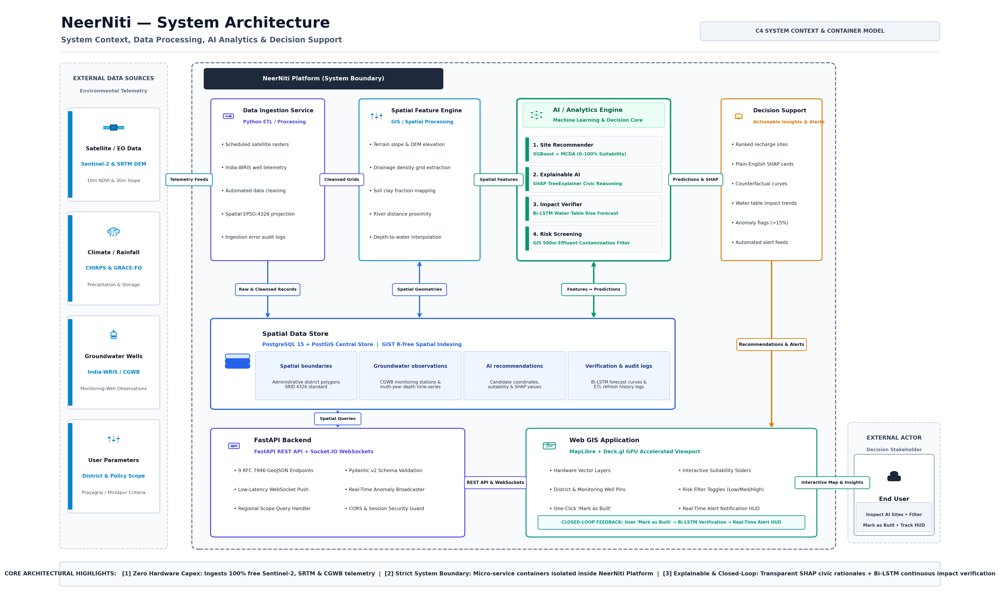

# 🌊 NeerNiti: An End-to-End Satellite Telemetry and Deep Learning Platform for Sustainable Regional Groundwater Management
### *Intelligent Decisions. Verifiable Outcomes. Sustainable Future.*

<p align="center">
  
  
  
  
  
  
  
  
  
</p>

---

## 📌 Table of Contents
1. [Executive Summary & Problem Statement](#-executive-summary--problem-statement)
2. [Key Innovations & Closed-Loop Lifecycle](#-key-innovations--closed-loop-lifecycle)
3. [System Architecture Diagram](#-system-architecture-diagram)
4. [Core AI & Analytics Engines](#-core-ai--analytics-engines)
   - [Module 1: Site Suitability Recommender](#1-module-1-site-suitability-recommender-catboost--mcda)
   - [Module 2: Explainable AI & Civic Reasoning](#2-module-2-explainable-ai--civic-reasoning-shap)
   - [Module 3: Verification & Impact Monitoring](#3-module-3-verification--impact-monitoring-bi-lstm)
   - [Module 4: Water Quality & Risk Screening](#4-module-4-module-4-water-quality--risk-screening)
5. [Complete Hardware & Software Version Matrix](#-complete-hardware--software-version-matrix)
   - [System & Runtimes](#1-core-system--runtimes)
   - [Python Backend & ML Dependencies](#2-python-backend--ml-dependencies-requirements-matrix)
   - [Frontend & UI Framework Dependencies](#3-frontend--ui-framework-dependencies-packagejson-matrix)
   - [Geospatial & Container Infrastructure](#4-geospatial--container-infrastructure)
6. [Detailed Step-by-Step Setup Guide](#-detailed-step-by-step-setup-guide)
   - [Prerequisites Verification](#step-0-prerequisites-verification)
   - [Step 1: Clone Repository](#step-1-clone-repository)
   - [Step 2: Environment Configuration](#step-2-environment-configuration)
   - [Step 3: Database & PostGIS Setup (Docker)](#step-3-database--postgis-setup-docker)
   - [Step 4: Database Schema Migrations](#step-4-database-schema-migrations)
   - [Step 5: Backend API Service Startup](#step-5-backend-api-service-startup)
   - [Step 6: Frontend Web GIS Portal Startup](#step-6-frontend-web-gis-portal-startup)
   - [Step 7: Data Ingestion & Model Inference Execution](#step-7-data-ingestion--model-inference-execution)
   - [Step 8: Automated Test Suite & Validation](#step-8-automated-test-suite--validation)
7. [API & Real-Time WebSocket Specifications](#-api--real-time-websocket-specifications)
8. [Repository Directory Layout](#-repository-directory-layout)
9. [Academic Baseline & References](#-academic-baseline--references)
10. [License & Acknowledgments](#-license--acknowledgments)

---

## 📖 Executive Summary & Problem Statement

India faces a severe groundwater crisis: despite constructing over **2.76 million artificial recharge structures** (against an original target of 1 million), approximately **14% of the country's groundwater assessment units remain severely over-exploited**.

This paradox stems from three critical vulnerabilities in current governance:
1. **Manual, Static Site Selection:** Conventional site identification relies on expert-driven GIS overlay techniques like Analytic Hierarchy Process (AHP). These methods are subjective, human-resource constrained, uncalibrated against historical telemetry, and cannot dynamically scale over millions of square kilometers.
2. **"Build and Forget" Policy (Zero Post-Construction Verification):** Government initiatives track structures built, but lack scientific mechanisms to verify whether completed recharge pits, check dams, or injection wells are actually replenishing nearby aquifers.
3. **Black-Box Skepticism:** Technical hydrological models often fail to translate into civic trust because local district magistrates and panchayats are not presented with explainable, plain-language rationales for site allocations.

**NeerNiti** is a zero-hardware-capex, cloud-native, end-to-end artificial intelligence and geospatial decision-support system. It automatically ingests free public Earth Observation (EO) telemetry (Copernicus Sentinel-2, NASA SRTM DEM, CHIRPS rainfall, GRACE-FO gravity anomalies, and CGWB/India-WRIS well monitoring telemetry), pinpoints high-potential recharge locations via calibrated gradient boosting models, provides plain-English SHAP civic reasoning, and continuously verifies hydrological replenishment using Bidirectional LSTMs.

---

## 🔄 Key Innovations & Closed-Loop Lifecycle

```
    ┌─────────────────────────────────────────────────────────────┐
    │                    1. SATELLITE INGESTION                   │
    │  Sentinel-2 (10m) + SRTM (30m) + CHIRPS + India-WRIS Telemetry  │
    └──────────────────────────────┬──────────────────────────────┘
                                   │
                                   ▼
    ┌─────────────────────────────────────────────────────────────┐
    │               2. SITE RECOMMENDATION (Module 1)             │
    │  CatBoost/XGBoost Spatial Classifier + Hydrogeological MCDA  │
    │         → High Suitability Candidate Coordinates             │
    └──────────────────────────────┬──────────────────────────────┘
                                   │
                                   ▼
    ┌─────────────────────────────────────────────────────────────┐
    │             3. CIVIC EXPLAINABILITY (Module 2)              │
    │  SHAP TreeExplainer → Plain-English Policy Cards            │
    │         → Risk Screening (500m Buffer Contamination Check)  │
    └──────────────────────────────┬──────────────────────────────┘
                                   │
                                   ▼
    ┌─────────────────────────────────────────────────────────────┐
    │                 4. GROUND ACTION & DEPLOYMENT               │
    │  Stakeholder Reviews Map → One-Click "Mark as Built"        │
    └──────────────────────────────┬──────────────────────────────┘
                                   │
                                   ▼
    ┌─────────────────────────────────────────────────────────────┐
    │             5. CLOSED-LOOP VERIFICATION (Module 3)          │
    │  Bi-LSTM Counterfactual Forecast vs Observed Telemetry      │
    │         → Replenishment Confirmation or Anomaly Alert       │
    └─────────────────────────────────────────────────────────────┘
```

* **Zero Hardware Capex:** Ingests 100% free, publicly available satellite constellations and national water telemetry.
* **Strict Evaluation Protocol:** Evaluated under **Repeated Stratified Leave-One-District-Out (LODO) Cross-Validation** over unseen hydrogeological clusters to guarantee generalization across unmonitored terrains.
* **True Closed-Loop Verification:** Links site sanctioning with post-construction telemetry tracking over a 12–24 month post-build window.

---

## 🏛️ System Architecture Diagram

### Visual Architectural Blueprint
The complete C4 System Context & Container blueprint is documented below:

<p align="center">
  
</p>

### Interactive Architecture Flow (Mermaid)

```mermaid
flowchart TB
    subgraph External_Data["🛰️ External Data Feeds (Zero Capex)"]
        S2["Sentinel-2 Level-2A<br/>(10m NDVI & Water Indices)"]
        SRTM["NASA SRTM DEM<br/>(30m Slope & Elevation)"]
        CHIRPS["CHIRPS Rainfall<br/>(Daily Precipitation Grids)"]
        GRACE["NASA GRACE-FO<br/>(Aquifer Mass Anomalies)"]
        WRIS["India-WRIS / CGWB<br/>(Telemetric Monitoring Wells)"]
    end

    subgraph Data_Pipeline["⚙️ Ingestion & Spatial ETL (Python / GEE)"]
        ETL["Ingestion Schedulers<br/>(fetch_chirps / fetch_gee_layers)"]
        GEE["Google Earth Engine API<br/>(Spatial Reducer & Vector Masking)"]
        QC["Outlier & Telemetry QC<br/>(Physical Bounds & Seasonal Pairing)"]
    end

    subgraph AI_Core["🧠 AI Analytics & Inference Engine"]
        M1["Module 1: Site Recommender<br/>(CatBoost Ensemble + MCDA)"]
        M2["Module 2: Explainable AI<br/>(SHAP TreeExplainer + LLM Advisor)"]
        M3["Module 3: Impact Verifier<br/>(Bi-LSTM Time-Series Forecasting)"]
        M4["Module 4: Risk Screener<br/>(500m Buffer Contamination Filter)"]
    end

    subgraph Spatial_Store["🗄️ Spatial Data Store (PostgreSQL 15 + PostGIS 3.3)"]
        PG[("PostGIS Central DB<br/>GIST Spatial R-Tree Indexing")]
        TB_Wells["monitoring_wells"]
        TB_Recs["recharge_recommendations"]
        TB_Structs["constructed_structures"]
        TB_Verif["verification_logs"]
    end

    subgraph Backend_Services["🚀 Backend Service Layer (FastAPI 0.115)"]
        API["FastAPI REST Engine<br/>(Pydantic v2 Schemas)"]
        GEOJSON["RFC 7946 GeoJSON Serializer"]
        WS["Python-SocketIO Server<br/>(Real-Time Alert Broadcasts)"]
    end

    subgraph Frontend_App["🖥️ Web GIS Interface (Next.js 14 + MapLibre + Deck.gl)"]
        DECK["Deck.gl GPU Vector Viewport<br/>(Hexagons & Suitability Layers)"]
        LEAFLET["Interactive Leaflet Map<br/>(Well Pins & 500m Hazard Buffers)"]
        HUD["Live Alert & Analytics HUD<br/>(Recharts Trend Curves & SHAP Cards)"]
    end

    %% Flow connections
    External_Data --> ETL
    ETL --> GEE
    GEE --> QC
    QC --> M1
    M1 --> M2
    M2 --> M4
    M4 --> API
    API --> PG
    PG --> TB_Wells
    PG --> TB_Recs
    PG --> TB_Structs
    PG --> TB_Verif
    API --> GEOJSON
    GEOJSON --> DECK
    GEOJSON --> LEAFLET
    WS --> HUD
    TB_Structs -.->|Feedback Trigger| M3
    M3 -.->|Verification Curves| WS
```



---

## 🧠 Core AI & Analytics Engines

### 1. Module 1: Site Suitability Recommender (CatBoost + MCDA)
* **Goal:** Classify 1km² spatial tiles into probabilistic recharge suitability categories (0% to 100%).
* **Feature Manifest (Deployable Telemetry):**
  - **Terrain Topography:** Elevation, slope angle (degrees), topographic wetness index (TWI), aspect.
  - **Hydrological Network:** Proximity to primary/secondary drainage, drainage density ($\text{km}/\text{km}^2$).
  - **Earth Surface Dynamics:** Pre- and post-monsoon NDVI, NDWI (surface water presence), normalized difference built-up index (NDBI).
  - **Lithology & Pedology:** Subsurface lithological classification (Alluvial, Bhabar-Terai, Bundelkhand crystalline basement) and SoilGrids clay percentage (0–30cm depth).
* **Validation Rigor:** Evaluated via **Repeated Stratified Leave-One-District-Out (LODO) Cross-Validation** over 15 folds with 3 distinct random seeds (Seed 42, 100, 2024), ensuring zero spatial data leakage.

### 2. Module 2: Explainable AI & Civic Reasoning (SHAP)
* **Goal:** Remove the "black box" stigma by producing plain-English civic justifications for panchayat heads, municipal commissioners, and hydrologists.
* **Architecture:**
  - Extracts local Shapley attributions using `shap.TreeExplainer`.
  - Normalizes feature contributions into positive drivers (e.g., *“High slope permeability (+28%) and proximity to seasonal drainage (+21%)”*) vs. inhibiting factors (*“High soil clay fraction (-14%)”*).
  - Integrates an optional LLM synthesis pipeline (OpenRouter / Google Gemini) to convert technical attributions into regional-language policy briefs.

### 3. Module 3: Verification & Impact Monitoring (Bi-LSTM)
* **Goal:** Verify that a newly constructed structure has replenished the local water table over a 12–24 month post-build horizon.
* **Architecture:**
  - A dual-layer **Bidirectional Long Short-Term Memory (Bi-LSTM)** network trained on multi-year India-WRIS depth-to-water level (mbgl) trajectories.
  - Generates a **counterfactual trajectory** (what water levels *would* have been under observed rainfall had the structure not been constructed).
  - Compares the observed telemetry curve with the counterfactual forecast. If net replenishment exceeds the expected baseline by $> 15\%$, a verified certificate is issued; if water levels stagnate or decline, an automated inspection flag is broadcast via WebSockets.

### 4. Module 4: Water Quality & Risk Screening
* **Goal:** Prevent toxic aquifer contamination by filtering out high-suitability sites situated within environmental hazard zones.
* **Architecture:**
  - Fast spatial buffer queries ($500\text{m}$ Euclidean buffer via PostGIS `ST_DWithin`).
  - Cross-references locations against industrial effluent discharges, high-salinity pockets, arsenic/fluoride hotspot records, and solid waste landfills.
  - Outputs a multi-level risk rating (`LOW`, `MODERATE`, `HIGH_RISK_REJECTED`).

---

## 📦 Complete Hardware & Software Version Matrix

To guarantee **100% reproducible deployments without version conflicts**, all dependencies and runtimes are explicitly pinned below.

### 1. Core System & Runtimes

| Component | Tested Version | Compatible Range | Installation Verification Command |
|---|---|---|---|
| **Operating System** | Windows 11 / Ubuntu 22.04 LTS | Windows 10/11, macOS 13+, Linux | `cmd /c ver` or `uname -a` |
| **Python** | **`3.11.9`** | `3.10.x` – `3.11.x` | `python --version` |
| **Node.js** | **`v22.19.0`** | `v20.x` – `v22.x` (LTS) | `node --version` |
| **npm** | **`11.6.0`** | `10.x` – `11.x` | `npm --version` |
| **Docker Engine** | **`27.x`** | `24.x` – `28.x` | `docker --version` |
| **Docker Compose** | **`v2.x`** | `v2.20+` | `docker compose version` |

---

### 2. Python Backend & ML Dependencies (`requirements.txt` Matrix)

| Package | Exact Version | Functional Role in NeerNiti |
|---|---|---|
| **`fastapi`** | `0.115.12` | High-performance asynchronous REST API framework |
| **`uvicorn[standard]`** | `0.34.2` | Production ASGI web server with uvloop & httptools |
| **`pydantic`** | `2.12.0` | Strict data validation and RFC 7946 GeoJSON model enforcement |
| **`pydantic-settings`** | `2.11.0` | Hierarchical `.env` configuration management |
| **`sqlalchemy`** | `2.0.44` | Next-generation asynchronous & declarative SQL ORM |
| **`geoalchemy2`** | `0.20.0` | PostGIS spatial extensions and geometry mapping for SQLAlchemy |
| **`psycopg2-binary`** | `2.9.12` | Optimized C-extension PostgreSQL database adapter |
| **`alembic`** | `1.17.0` | Database schema migrations and version-controlled DDL |
| **`shapely`** | `2.1.2` | High-speed computational geometry and polygon intersection |
| **`python-socketio`** | `5.16.4` | Full-duplex WebSocket server for live telemetry & anomaly alerts |
| **`python-engineio`** | `4.13.5` | Transport engine for real-time WebSocket communication |
| **`python-dotenv`** | `1.1.0` | Secure environment variable isolation |
| **`requests`** | `2.34.2` | Synchronous HTTP client for external government portal scraping |
| **`httpx`** | `0.28.1` | Asynchronous HTTP client for non-blocking telemetry fetches |
| **`numpy`** | `2.2.5` | Vectorized numerical computing and spatial array transforms |
| **`pandas`** | `3.0.5` | Tabular data processing, seasonal aggregation, and feature tables |
| **`scipy`** | `1.17.1` | Scientific spatial interpolation and BallTree distance queries |
| **`scikit-learn`** | `1.6.1` | Stratified Group K-Fold, metrics evaluation, baseline regressors |
| **`catboost`** | `1.2.8` | High-accuracy symmetric decision trees for spatial classification |
| **`xgboost`** | `3.2.0` | Gradient-boosted decision trees for multi-criteria site suitability |
| **`shap`** | `0.51.0` | Game-theoretic TreeExplainer for civic explainability |
| **`joblib`** | `1.4.2` | Efficient model weights, scalers, and pipeline serialization |
| **`tensorflow`** | `2.21.0` | Deep learning backend for Bi-LSTM water-table verification |
| **`earthengine-api`** | `1.7.43` | Google Earth Engine Python SDK for cloud satellite processing |
| **`google-api-python-client`** | `2.193.0` | Google Cloud API interaction and Earth Engine auth transport |
| **`google-auth`** | `2.49.0` | Service account token authentication |

---

### 3. Frontend & UI Framework Dependencies (`package.json` Matrix)

| Package | Version | Functional Role in NeerNiti |
|---|---|---|
| **`next`** | `14.2.35` | React framework with App Router, server-rendered components, SSR |
| **`react`** | `18.3.1` | UI component library |
| **`react-dom`** | `18.3.1` | React DOM renderer |
| **`deck.gl`** | `9.0.0` | WebGL2 GPU-accelerated massive geospatial data visualization |
| **`@deck.gl/react`** | `9.0.0` | React wrapper for Deck.gl canvas viewports |
| **`@deck.gl/layers`** | `9.0.0` | Core Deck.gl layers (Scatterplot, PathLayer, PolygonLayer) |
| **`@deck.gl/geo-layers`** | `9.0.0` | H3HexagonLayer, Tile3DLayer, and GeoJsonLayer support |
| **`maplibre-gl`** | `4.1.0` | Open-source vector basemap rendering engine (CartoDB/OSM) |
| **`leaflet`** | `1.9.4` | Mobile-friendly interactive raster and vector mapping |
| **`react-leaflet`** | `4.2.1` | React bindings for Leaflet map elements |
| **`recharts`** | `2.12.3` | Declarative chart library for Bi-LSTM verification forecast curves |
| **`socket.io-client`** | `4.7.5` | Client-side WebSocket client for real-time alerts |
| **`zustand`** | `4.5.2` | Lightweight centralized client state store for map filters |
| **`@tanstack/react-query`** | `5.28.0` | Server state management, auto-caching, and background re-fetching |
| **`lucide-react`** | `0.359.0` | Clean icon suite for geospatial HUD and navigation |
| **`tailwindcss`** | `3.4.1` | Utility-first CSS framework with custom glassmorphism design tokens |
| **`typescript`** | `5.4.3` | Static typing and compiler checks |

---

### 4. Geospatial & Container Infrastructure

| Service | Image / Version | Port | Storage / Persistence |
|---|---|---|---|
| **PostGIS Database** | `postgis/postgis:15-3.3` | `5432:5432` | Docker Volume: `neerniti_db_data` |
| **FastAPI Backend** | Python 3.11 ASGI Container / Local | `8000:8000` | Stateless (logs & model weights) |
| **Next.js Web Portal** | Node.js 22 Next Standalone / Dev | `3000:3000` | Ephemeral client bundle |

---

## 🛠️ Detailed Step-by-Step Setup Guide

Follow this guide sequentially to set up and run the entire NeerNiti stack on your local machine.

### Step 0: Prerequisites Verification

Open your terminal (PowerShell on Windows, or bash on Linux/macOS) and verify that the base runtimes are installed:

```bash
# Check Python (must be 3.10+ or 3.11.x)
python --version

# Check Node.js (must be 20.x or 22.x)
node --version

# Check Docker
docker --version
docker compose version
```

---

### Step 1: Clone Repository

```bash
# Clone the repository
git clone https://github.com/GhoshChinmay/NeerNiti.git

# Enter project root directory
cd NeerNiti
```

---

### Step 2: Environment Configuration

NeerNiti uses isolated environment variables for database connections, satellite credentials, and optional LLM keys.

1. **Create your `.env` configuration from the provided template:**
   ```bash
   # On Windows (PowerShell):
   Copy-Item .env.example .env
   Copy-Item .env.example backend/.env

   # On Linux / macOS (bash):
   cp .env.example .env
   cp .env.example backend/.env
   ```

2. **Inspect & Customize `.env`:**
   Open `.env` in your editor. For a quick local development startup, the default database credentials will work out of the box with Docker:
   ```env
   # Database Credentials
   POSTGRES_USER=neerniti_admin
   POSTGRES_PASSWORD=neerniti_local_dev_password
   POSTGRES_DB=neerniti_db
   POSTGRES_PORT=5432
   POSTGRES_HOST=localhost

   # Google Earth Engine (Optional for live on-the-fly extraction)
   GEE_SERVICE_ACCOUNT_EMAIL=your-sa@your-project.iam.gserviceaccount.com
   GEE_PRIVATE_KEY_PATH=backend/ee-credentials.json

   # LLM Advisory Provider (Optional: OpenRouter or Gemini)
   OPENROUTER_API_KEY=your_key_here
   LLM_PROVIDER=openrouter
   ```
   > 🔒 **Security Notice:** The `.gitignore` file is strictly pre-configured to prevent `.env`, service account JSON files, and secret keys from ever being committed to Git.

---

### Step 3: Database & PostGIS Setup (Docker)

Start the PostgreSQL 15 container equipped with the PostGIS 3.3 spatial extension:

```bash
# Launch database container in background
docker compose up -d db

# Verify the container is running and healthy
docker ps
```

*To verify that the PostGIS extension is active, run:*
```bash
docker exec -it neerniti_db psql -U neerniti_admin -d neerniti_db -c "SELECT PostGIS_Version();"
```
*Expected output:* `3.3.x`

---

### Step 4: Database Schema Migrations

Apply the Alembic migration files to create all required spatial tables, foreign keys, and GIST indices:

```bash
# Navigate to backend directory
cd backend

# Create and activate a Python virtual environment
# Windows (PowerShell):
python -m venv venv
.\venv\Scripts\Activate.ps1

# Linux / macOS (bash):
python -m venv venv
source venv/bin/activate

# Install backend dependencies with exact pinned versions
pip install -r requirements.txt

# Run Alembic migrations to apply DB schema
alembic upgrade head
```

---

### Step 5: Backend API Service Startup

With the database initialized and virtual environment activated, launch the FastAPI server:

```bash
# From within the /backend directory:
uvicorn app.main:app --reload --host 0.0.0.0 --port 8000
```

* **API Root:** `http://localhost:8000`
* **Interactive Swagger UI Documentation:** `http://localhost:8000/docs`
* **Alternative Redoc Documentation:** `http://localhost:8000/redoc`
* **WebSocket Server:** `ws://localhost:8000/socket.io/`

---

### Step 6: Frontend Web GIS Portal Startup

Open a **new terminal tab/window** for the Next.js frontend:

```bash
# From the project root:
cd frontend

# Install Node dependencies using package-lock.json
npm install

# Start the Next.js development server with Turbopack acceleration
npm run dev
```

* **Interactive Web GIS Portal:** Open **`http://localhost:3000`** in your browser.
* **Administrative Site Management:** Open **`http://localhost:3000/admin`**.

---

### Step 7: Data Ingestion & Model Inference Execution

To run the automated ingestion pipelines and generate fresh candidate site recommendations:

```bash
# Ensure backend virtual environment is active:
# Ingest India-WRIS Well Telemetry
python ingestion/fetch_india_wris.py

# Ingest CHIRPS Precipitation Data
python ingestion/fetch_chirps.py

# Run Multi-District Model Inference (Generates suitability predictions)
python backend/app/ml/run_multidistrict_inference.py

# Run Verification Engine (Tests Bi-LSTM replenishment on constructed sites)
python backend/app/ml/run_verification.py
```

---

### Step 8: Automated Test Suite & Validation

Execute the automated test suite covering unit endpoints, spatial queries, and ML prediction pipelines:

```bash
# From within the /backend directory:
pytest -v tests/
```

*Output summary should verify:*
- ✅ `test_api_endpoints.py`: All 9 RFC 7946 GeoJSON endpoints return HTTP 200.
- ✅ `test_ml_modules.py`: Model weights load and yield calibrated probabilities $\in [0, 1]$.
- ✅ `test_system_e2e.py`: End-to-end integration across PostGIS, FastAPI, and WebSocket broadcasts.

---

## 📡 API & Real-Time WebSocket Specifications

### Core REST Endpoints (RFC 7946 GeoJSON Compliant)

| Method | Endpoint | Description | Query Parameters |
|---|---|---|---|
| `GET` | `/api/v1/health` | Service and PostGIS database liveness check | None |
| `GET` | `/api/v1/recommendations` | FeatureCollection of candidate recharge sites | `district`, `min_suitability`, `risk_level` |
| `GET` | `/api/v1/recommendations/{id}/explain` | SHAP civic explanation and feature attribution | `language` (`en` or `hi`) |
| `GET` | `/api/v1/wells` | India-WRIS observation wells with historical telemetry | `district`, `year` |
| `GET` | `/api/v1/structures` | Verified and marked artificial recharge structures | `status` (`candidate`, `in_progress`, `built`) |
| `POST`| `/api/v1/structures/mark-as-built` | Promotes a candidate site to built status | Body: `{ site_id, completion_date, structure_type }` |
| `GET` | `/api/v1/verify/{structure_id}` | Bi-LSTM counterfactual trajectory and anomaly flag | None |
| `GET` | `/api/v1/districts` | Administrative boundary polygons with vulnerability index | `state` (`UP`, `Assam`, etc.) |

### Real-Time WebSocket Events (`python-socketio`)

* **Client Connects:** `ws://localhost:8000/socket.io/`
* **Emitted Events:**
  - `structure_built`: Triggered when an engineer clicks "Mark as Built", broadcasting immediate visual updates to all connected dashboards.
  - `verification_alert`: Emitted when the Bi-LSTM model flags a post-construction replenishment anomaly ($> 15\%$ drift).
  - `telemetry_refresh`: Periodic notification when new satellite passes or well readings are ingested.

---

## 📂 Repository Directory Layout

```text
NeerNiti/
├── .github/
│   └── workflows/
│       └── scheduled_data_refresh.yml   # Daily GitHub Actions automated ingestion CI/CD
├── backend/
│   ├── alembic/                         # Database migration scripts (Versions 0001–0005)
│   ├── app/
│   │   ├── api/v1/                      # FastAPI endpoints (recommendations, wells, verify)
│   │   ├── db/                          # SQLAlchemy models, PostGIS connection, repositories
│   │   ├── ml/                          # Core Machine Learning & AI Modules
│   │   │   ├── module1_recommendation/  # CatBoost/XGBoost spatial recommender
│   │   │   ├── module2_explainability/  # SHAP TreeExplainer & civic translation
│   │   │   ├── module3_verification/    # Bi-LSTM time-series forecasting model
│   │   │   ├── module4_risk_screening/  # 500m GIS buffer contamination screener
│   │   │   ├── llm_advisor.py           # Multi-provider LLM civic synthesizer
│   │   │   ├── run_multidistrict_inference.py # Inference runner
│   │   │   └── run_verification.py      # Verification pipeline runner
│   │   └── models/                      # Pydantic v2 schemas and GeoJSON models
│   ├── tests/                           # Pytest test suite (unit, integration, e2e)
│   ├── .env.example                     # Backend environment variable template
│   ├── alembic.ini                      # Alembic configuration
│   ├── main.py                          # FastAPI application initialization & ASGI entrypoint
│   └── requirements.txt                 # Pinned backend dependencies
├── frontend/
│   ├── public/                          # Static assets and WebApp manifest
│   ├── src/
│   │   ├── app/                         # Next.js 14 App Router (page.tsx, portal, admin)
│   │   ├── components/
│   │   │   ├── charts/                  # Recharts verification and water-level curves
│   │   │   ├── dashboard/               # Sidebars, stats cards, modals, region selectors
│   │   │   ├── map/                     # Deck.gl & Leaflet GPU map wrappers
│   │   │   └── notifications/           # Real-time WebSocket toast HUD
│   │   ├── lib/                         # API client, WebSocket bindings, TypeScript types
│   │   └── store/                       # Zustand client state stores
│   ├── Dockerfile                       # Multi-stage Next.js production Dockerfile
│   ├── package.json                     # Frontend dependencies & scripts
│   ├── package-lock.json                # Pinned frontend lockfile
│   ├── tailwind.config.ts               # Tailwind design system configuration
│   └── tsconfig.json                    # TypeScript compiler configuration
├── docs/                                # Full engineering & architectural specification
│   ├── AI_Powered_Water_Recharge_PRD.md # Product Requirements Document
│   ├── AI_Powered_Water_Recharge_Architecture.md # High-Level System Architecture
│   ├── Database_Design.md               # PostGIS schema & indexing documentation
│   ├── ML_Model_Design.md               # Model math, loss functions, & feature engineering
│   ├── System_Design.md                 # Low-level design & class structures
│   ├── UI_UX_Design.md                  # Design tokens, accessibility, wireframes
│   └── neerniti_system_architecture.png # C4 System Architecture Diagram
├── ingestion/                           # Scheduled Earth Observation ETL scripts
│   ├── fetch_chirps.py                  # CHIRPS daily precipitation ingestion
│   ├── fetch_gee_layers.py              # Google Earth Engine multi-band raster extractor
│   ├── fetch_grace_fo.py                # NASA GRACE-FO terrestrial water anomaly ingestion
│   └── fetch_india_wris.py              # Central Ground Water Board telemetry ingestion
├── notebooks/                           # Model research & training notebooks
│   ├── NeerNiti_UP_Model_Training_v13_0.ipynb # Production CatBoost LODO-CV pipeline
│   └── NeerNiti_Module3_Verification_Training.ipynb # Bi-LSTM Verification training
├── Reference Paper/                     # Curated hydrogeology & ML research papers
├── .env.example                         # Root environment variable template
├── .gitignore                           # Strict zero-secrets & clean Git ignore rules
├── docker-compose.yml                   # PostGIS & multi-container orchestration
├── requirements.txt                     # Root pinned dependencies
└── README.md                            # Primary project documentation & setup guide
```

---

## 📚 Academic Baseline & References

NeerNiti builds upon foundational hydrogeological remote sensing and machine learning literature:

1. **Primary Architectural Base Paper:**
   * Patidar, N., Yadav, B., Kumar, S. et al. (2023). *A Web-Enabled Tool for Site Suitability Mapping for Managed Aquifer Recharge (MAR) Using Google Earth Engine (GEE) and Multi-Criteria Decision Analysis (MCDA)*. **Water Resources Management**, 37(14), 5619–5634.
2. **Groundwater Potential Mapping with Machine Learning:**
   * Karbi Anglong ML Case Study (2022). *Groundwater potential mapping using machine learning models for Northeastern Karbi Anglong district, Assam, India*.
   * Eastern India Boosting Benchmark (2023). *Application of Bagging and Boosting Ensemble Machine Learning Techniques for Groundwater Potential Mapping in a Drought-Prone District of Eastern India*.
3. **Deep Learning Hydrological Forecasting:**
   * CGWB & MoJS Technical Guidance on Managed Aquifer Recharge Master Plans (2020–2024).

---

## 📄 License & Acknowledgments

* **License:** Distributed under the **MIT License**. See `LICENSE` for details.
* **Author & Lead Developer:** **Chinmay Ghosh**
* **Data Providers:**
  - Copernicus European Space Agency (Sentinel-2 MSI)
  - NASA Jet Propulsion Laboratory (SRTM DEM, GRACE-FO)
  - Climate Hazards Center, UC Santa Barbara (CHIRPS)
  - Central Ground Water Board (CGWB) & Ministry of Jal Shakti, Government of India (India-WRIS)

---
<p align="center">
  <b>NeerNiti</b> — <i>Securing India's Aquifers through Scientific Intelligence.</i>
</p>