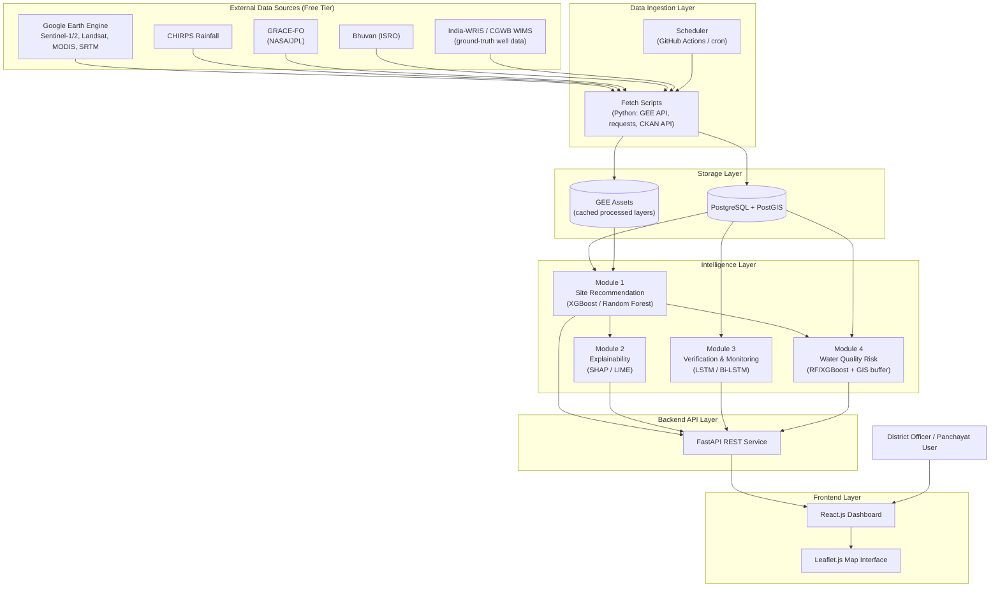
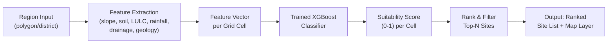
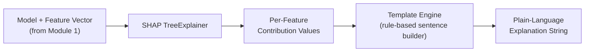
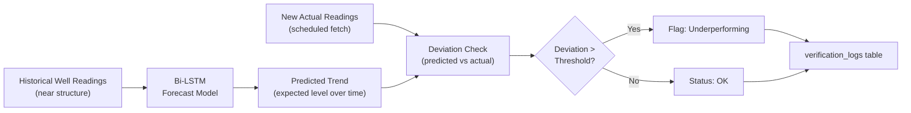
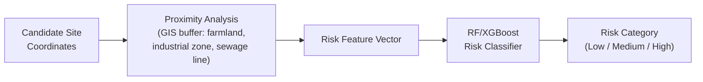
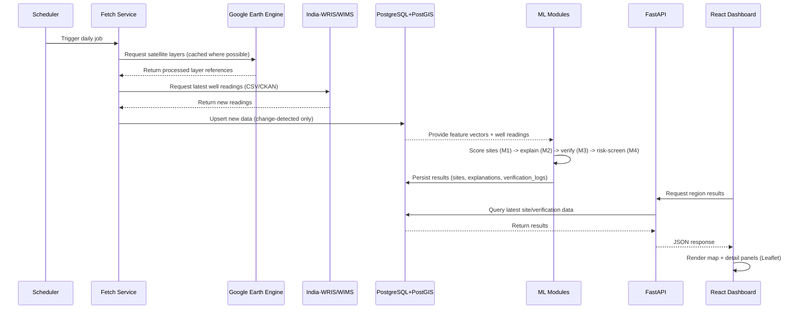
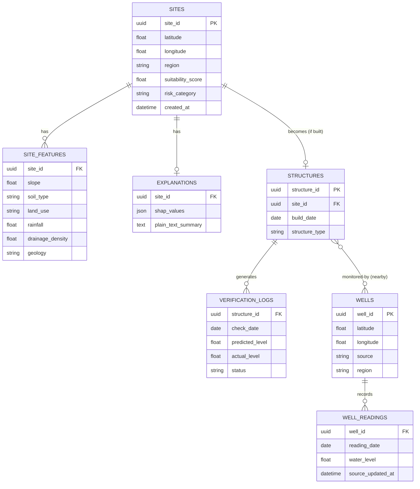
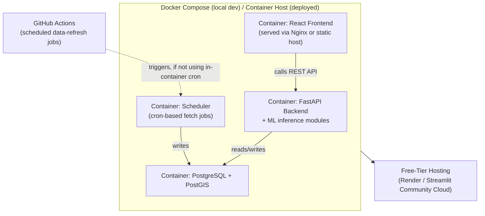

# System Architecture Document
## AI Powered Water Recharge

| | |
|---|---|
| **Document Version** | 1.0 |
| **Companion Document** | AI_Powered_Water_Recharge_PRD.md |
| **Architecture Style** | Modular monolith (service-oriented internally), containerized, cloud-native data ingestion |
| **Status** | Draft for Panel Review |

---

## 1. Architecture Principles

This system is designed around five guiding principles, chosen specifically for a free-tier, student-built, 12-month academic project:

1. **Software-only, zero hardware** — every data need is satisfied by satellite platforms or existing government sensor networks, never by devices we build or deploy.
2. **Cost-zero by design** — every technology choice must operate within a free tier (Google Earth Engine, free-tier hosting, open-source libraries).
3. **Modular over monolithic-in-spirit** — each of the four intelligence modules (Recommendation, Explainability, Verification, Quality Screening) is built as an independently testable component behind a shared API layer, even though they may be deployed together as one service for simplicity.
4. **Explainability is architectural, not optional** — the explainability layer is wired directly into the inference path of every model-producing module, not bolted on afterward.
5. **Batch/scheduled over real-time streaming** — since groundwater changes slowly, the architecture favors scheduled data refresh (daily/periodic) over complex real-time streaming infrastructure, which would add cost and complexity with no real benefit.

---

## 2. High-Level System Architecture



---

## 3. Component Architecture

### 3.1 Module 1 — Site Recommendation Engine

**Responsibility:** Given a region, produce a ranked list of geographic candidate points for new recharge structures.



- **Input:** GeoJSON polygon or district identifier
- **Processing:** Pulls cached feature layers from PostGIS/GEE Assets, builds a per-grid-cell feature vector, scores each cell
- **Output:** Ranked site list (lat/lon + score), GeoJSON suitability layer
- **Model refresh policy:** Manually triggered retraining for MVP; scheduled monthly retraining as a stretch goal

### 3.2 Module 2 — Explainability Layer

**Responsibility:** Attach a human-readable justification to every score Module 1 produces.



- **Input:** Trained model object + the specific feature vector for one site
- **Processing:** SHAP computes marginal contribution of each feature; top 2–3 contributing factors are converted into a sentence template (e.g., `"High suitability due to {factor_1} and {factor_2}"`)
- **Output:** JSON object `{site_id, shap_values, explanation_text}`
- **Design note:** This module never runs standalone — it is invoked immediately after Module 1 produces a score, so every recommendation is explainable by construction, not by later addition

### 3.3 Module 3 — Recharge Verification & Monitoring

**Responsibility:** Determine whether a specific structure is actually producing a measurable groundwater recharge effect.



- **Input:** Structure ID, associated nearby well IDs, historical + newly fetched readings
- **Processing:** Bi-LSTM forecasts the expected level trajectory; each scheduled refresh compares new actual data against the forecast
- **Output:** Status flag (OK / Underperforming) + logged history entry
- **Trigger:** Runs on the same scheduled cadence as the India-WRIS data refresh job (daily/periodic)

### 3.4 Module 4 — Water Quality Risk Screener

**Responsibility:** Assign a contamination risk category to a candidate site before it is finalized as a recommendation.



- **Input:** Candidate site coordinates from Module 1
- **Processing:** GIS buffer analysis computes distance-based features; classifier assigns a risk category
- **Output:** Risk label attached to the site record before it's surfaced to the frontend

---

## 4. Data Flow Architecture



---

## 5. API Architecture (REST Endpoints)

| Method | Endpoint | Purpose |
|---|---|---|
| `GET` | `/api/v1/regions` | List selectable regions (state/district) |
| `POST` | `/api/v1/sites/recommend` | Run/retrieve site recommendations for a given region polygon |
| `GET` | `/api/v1/sites/{site_id}` | Get full detail for a single site (score, explanation, risk) |
| `GET` | `/api/v1/sites/{site_id}/explanation` | Get SHAP-based explanation for a site |
| `GET` | `/api/v1/structures/{structure_id}/verification` | Get verification history/status for a built structure |
| `POST` | `/api/v1/structures` | Register a newly built structure against a recommended site |
| `GET` | `/api/v1/wells/{well_id}/readings` | Get historical readings for a well |
| `GET` | `/api/v1/data-refresh/status` | Get last successful ingestion run timestamp per source |
| `GET` | `/api/v1/health` | Service health check |

**API design notes:**
- All endpoints return JSON; geospatial results additionally support GeoJSON via an `?format=geojson` query parameter for direct Leaflet consumption.
- Long-running recommendation requests (large regions) are handled asynchronously: `POST /sites/recommend` returns a `job_id` immediately, with results polled via `GET /api/v1/jobs/{job_id}`.
- Authentication is out of scope for the academic MVP (single-tenant demo deployment); noted as a future-scope item for production use.

---

## 6. Database Architecture (Entity Relationships)



---

## 7. Data Ingestion & Scheduling Architecture

| Job | Frequency | Source | Mechanism |
|---|---|---|---|
| Satellite layer refresh | Weekly (or on-demand for prototyping) | GEE (Sentinel, Landsat, MODIS, SRTM) | GEE Python API script, results cached as GEE Assets |
| Rainfall data refresh | Monthly | CHIRPS | GEE or direct CHC bulk download |
| Groundwater storage refresh | Monthly | GRACE-FO | Direct NASA/JPL download script |
| Well-level data refresh | Daily | India-WRIS / India Data Portal (CKAN) | Scheduled fetch script with change-detection (timestamp/hash comparison) |
| Verification re-check | Daily (same trigger as well-level refresh) | Internal (Module 3) | Runs immediately after new well data lands |
| Model retraining | Manual (MVP) / Monthly (stretch) | Internal | Triggered script; stores versioned model artifact |

**Change-detection strategy:** Rather than reprocessing all data on every run, the fetch service compares the source's last-modified timestamp (or a content hash) against the `data_refresh_log` table and only ingests genuinely new records — this keeps both database writes and GEE compute usage minimal.

---

## 8. Deployment Architecture



- **Local development:** `docker-compose` spins up all four containers together for development/testing.
- **Deployed environment:** Backend + database deployed to a free-tier host (Render); scheduled ingestion jobs run via GitHub Actions rather than an always-on container, to avoid consuming free-tier compute hours unnecessarily.
- **Frontend:** Built as a static React bundle, served independently (Render static site or Streamlit Community Cloud, depending on final framework choice).

---

## 9. Security & Configuration Architecture

| Concern | Approach |
|---|---|
| API keys / credentials (GEE service account, NASA Earthdata login) | Stored as environment variables / repository secrets, never committed to source control |
| Database credentials | Environment variables, injected at container runtime |
| Public data exposure | All source data used is already publicly published government/satellite data; no personally identifiable information is collected or stored |
| Input validation | All FastAPI endpoints use Pydantic models for strict request validation |
| Rate-limiting external calls | Fetch scripts implement backoff/retry logic and respect a conservative polling frequency (daily, not aggressive) to avoid overloading public government portals |

---

## 10. Repository / Folder Structure

```
ai-powered-water-recharge/
├── backend/
│   ├── app/
│   │   ├── api/                 # FastAPI route definitions
│   │   ├── models/               # Pydantic request/response schemas
│   │   ├── ml/
│   │   │   ├── module1_recommendation/
│   │   │   ├── module2_explainability/
│   │   │   ├── module3_verification/
│   │   │   └── module4_risk_screening/
│   │   ├── db/                   # SQLAlchemy models, migrations
│   │   └── main.py
│   ├── Dockerfile
│   └── requirements.txt
├── ingestion/
│   ├── fetch_gee_layers.py
│   ├── fetch_chirps.py
│   ├── fetch_grace_fo.py
│   ├── fetch_india_wris.py
│   └── scheduler_config.yml       # GitHub Actions workflow definitions
├── frontend/
│   ├── src/
│   │   ├── components/
│   │   ├── pages/
│   │   └── App.jsx
│   ├── package.json
│   └── Dockerfile
├── notebooks/                     # Model training/experimentation notebooks
├── docs/
│   ├── AI_Powered_Water_Recharge_PRD.md
│   ├── AI_Powered_Water_Recharge_Architecture.md
│   └── Literature_Review.pdf
├── docker-compose.yml
└── README.md
```

---

## 11. Error Handling & Monitoring

| Layer | Strategy |
|---|---|
| Data ingestion scripts | Try/except around every external call; failures logged to `data_refresh_log` with status and error message, not silently swallowed |
| GEE quota exhaustion | Fetch scripts check remaining quota where possible; gracefully degrade to cached/last-known-good data rather than failing the whole pipeline |
| ML inference errors | API layer returns a structured error response (HTTP 4xx/5xx with message) rather than an unhandled exception |
| Frontend | Displays a clear "data temporarily unavailable" state rather than a blank map if the backend call fails |
| Monitoring (lightweight, free) | GitHub Actions job status serves as the primary ingestion health signal; optional Google Cloud Monitoring alert on GEE quota threshold |

---

## 12. Scalability Considerations (Beyond Academic Scope)

Documented for completeness / future-scope discussion with the panel, not required for MVP delivery:

- Moving from PostgreSQL to a managed geospatial database service for multi-state concurrent usage
- Introducing a message queue (e.g., Celery + Redis) for asynchronous large-region processing jobs
- Adding authentication/role-based access for multi-department real-world deployment
- Moving scheduled ingestion from GitHub Actions to a dedicated orchestration tool (Airflow) at larger scale

---

## 13. Architecture-to-Objective Traceability

| Objective (from PRD) | Architecture Component |
|---|---|
| O1 — Site Recommendation | Module 1, Data Ingestion Layer, Storage Layer |
| O2 — Explainability | Module 2 (chained directly after Module 1 in the inference path) |
| O3 — Verification | Module 3, scheduled well-data refresh job, verification_logs table |
| O4 — Quality Risk Screening | Module 4, GIS buffer analysis component |
| O5 — Deployed Platform | Backend API Layer + Frontend Layer + Deployment Architecture |

---

*End of Document*
