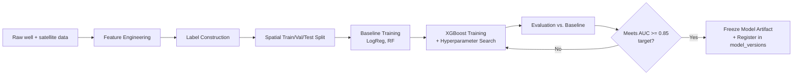
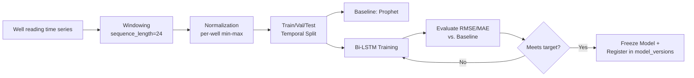

# ML Model Design Document
## AI Powered Water Recharge

| | |
|---|---|
| **Document Version** | 1.0 |
| **Companion Documents** | PRD.md, Architecture.md, Design.md, Database_Design.md, Rules.md, Phases.md |
| **Scope** | Problem framing, feature engineering, model architecture, training pipeline, evaluation, explainability integration, versioning, and retraining strategy for all four ML modules |
| **Status** | Draft for Panel Review |

---

## 1. ML Strategy Overview

This project uses **four distinct models**, each chosen to match the specific shape of its problem rather than forcing one architecture to do everything:

| Module | Problem Type | Model | Why This Shape of Model |
|---|---|---|---|
| 1. Site Recommendation | Binary/probabilistic classification over spatial grid cells | XGBoost (primary), Random Forest (baseline) | Tabular, mixed-type geospatial features — gradient boosting is the best-benchmarked approach across the literature review (AUC 0.82–0.98 range) |
| 2. Explainability | Model interpretation, not prediction | SHAP (TreeExplainer), LIME (secondary) | Post-hoc, model-agnostic explanation layer over Module 1's output |
| 3. Verification/Monitoring | Time-series forecasting | Bi-LSTM (primary), Facebook Prophet (baseline) | Sequential, temporally-dependent groundwater level data — recurrent architectures outperform tree models on this shape per literature (Malakar et al., DEBi-LSTM studies) |
| 4. Water Quality Risk | Multi-class classification | Random Forest / XGBoost | Tabular proximity features, small-to-medium labeled dataset — tree ensembles are appropriately powerful without excessive complexity |

**Cross-cutting design rule (per Rules.md Section 5):** every module trains a simple baseline before the "final" model, uses spatial (not random) cross-validation where data is geospatial, and is not considered complete until its explainability path is verified working.

---

## 2. Module 1 — Site Recommendation Engine

### 2.1 Problem Framing
Formulated as a **binary classification problem**: for a given grid cell, predict the probability that it is a "high groundwater potential" location, using historical well data as ground truth labels.

- **Label construction:** A well is labeled `1` (high potential) if its historical water-level readings place it in the top 40% of its region's readings (threshold configurable), else `0`. Grid cells without a nearby well inherit no direct label and are excluded from training (but still scored at inference time).
- **Unit of prediction:** one grid cell (default 250m × 250m, per Design.md Section 3.1).

### 2.2 Feature Set

| Feature | Source | Type | Engineering Notes |
|---|---|---|---|
| `slope_deg` | SRTM/Cartosat DEM | Continuous | Computed via `gdaldem slope` on the DEM raster |
| `drainage_density` | DEM-derived stream network | Continuous | Stream line length per unit area within a 1km moving window |
| `ndvi` | Sentinel-2 | Continuous | `(NIR - Red) / (NIR + Red)`, seasonal composite (post-monsoon) |
| `soil_type` | SoilGrids / Bhuvan | Categorical | One-hot encoded |
| `land_use` | Sentinel-2 classified LULC | Categorical | One-hot encoded |
| `rainfall_mm` | CHIRPS | Continuous | Annual + monsoon-season aggregate, 5-year rolling average |
| `geology_type` | Bhuvan | Categorical | One-hot encoded (alluvium, hard-rock, etc.) |
| `depth_to_groundwater_m` | Nearest well interpolation | Continuous | Inverse-distance-weighted interpolation from `well_readings` |
| `distance_to_river_m` | River/drainage vector layer | Continuous | Nearest-neighbor distance |

**Feature scaling:** tree-based models (XGBoost/RF) do not require feature scaling; categorical features are one-hot encoded rather than label-encoded, to avoid implying a false ordinal relationship.

**Feature order manifest:** the exact column order used at training time is persisted alongside the model artifact (per Design.md Section 3.1) to prevent silent feature-misalignment bugs at inference time — this is a common, easy-to-miss source of production ML bugs.

### 2.3 Model Architecture — XGBoost

```
Objective:        binary:logistic
Eval metric:       auc
Booster:            gbtree
```

| Hyperparameter | Search Range | Selection Method |
|---|---|---|
| `n_estimators` | 100 – 800 | Grid/random search with early stopping on validation AUC |
| `max_depth` | 3 – 10 | |
| `learning_rate` | 0.01 – 0.3 | |
| `subsample` | 0.6 – 1.0 | |
| `colsample_bytree` | 0.6 – 1.0 | |
| `min_child_weight` | 1 – 10 | |
| `scale_pos_weight` | computed from class ratio | Addresses class imbalance if high/low potential labels are skewed |

**Baseline model:** `LogisticRegression` (L2-regularized) and a default-parameter `RandomForestClassifier` are trained first; their AUC is recorded as the comparison floor per Rules.md Section 5.3.

### 2.4 Region-Aware Modeling
Per the literature review's identified gap ("India's regions are wildly different"), Module 1 does **not** use a single national model with no terrain awareness. Two approaches are supported, with the simpler one used for MVP:

- **MVP approach:** `geology_type` and `region` are included as strong categorical features, allowing one XGBoost model to learn region-conditional patterns.
- **Stretch approach (documented, not required for MVP):** train separate model instances per major terrain cluster (hard-rock, alluvial, coastal, arid) and route inference by region — evaluated only if the single-model approach shows clear regional bias in validation.

### 2.5 Training Pipeline



### 2.6 Spatial Cross-Validation Strategy
Random k-fold splitting is **explicitly disallowed** for this module (Rules.md Section 5.1) because neighboring grid cells share almost identical feature values, causing severe data leakage and artificially inflated validation scores. Instead:

- **Split unit:** district, not individual grid cell/well.
- **Method:** Group k-fold (k=5) where each fold holds out entire districts, ensuring the model is validated on genuinely unseen geography.
- **Test set:** 1–2 districts of a different terrain type than the training districts, to explicitly test cross-terrain generalization (directly addressing the "region diversity" gap from the literature review).

### 2.7 Evaluation Metrics & Targets

| Metric | Target | Rationale |
|---|---|---|
| AUC-ROC | >= 0.85 | Matches PRD Section 15 success criterion, within the literature-reported 0.82-0.98 range |
| F1-score | >= 0.80 | Balances precision/recall given moderate class imbalance |
| Precision @ Top-20 sites | Reported, no hard threshold | Reflects real usage — officers care most about whether the *top-ranked* sites are correct |

---

## 3. Module 2 — Explainability Layer

### 3.1 Explainer Choice
- **Primary: SHAP `TreeExplainer`** — exact, efficient Shapley value computation for tree-based models (XGBoost), used as the production explainer.
- **Secondary: LIME** — used during model validation only (Phase 4 per Phases.md) as a cross-check that SHAP's feature importances are consistent with a second, independent explanation method; not run in the production inference path (avoids double compute cost).

### 3.2 Explanation Generation Design

```python
def explain(model, feature_vector: dict) -> Explanation:
    explainer = shap.TreeExplainer(model)
    shap_values = explainer.shap_values(feature_vector_as_array)
    top_features = sorted(
        zip(feature_names, shap_values), key=lambda x: abs(x[1]), reverse=True
    )[:3]
    text_summary = render_template(top_features)
    return Explanation(shap_values=shap_values, top_contributions=top_features, text_summary=text_summary)
```

### 3.3 Template Rendering Rules (Deterministic, Not LLM-Based)
As established in Design.md Section 3.2, explanation text is generated via a rule-based template, not a language model — this keeps the explainability layer itself fully deterministic and auditable (no risk of a second "black box" on top of the first). The feature-name-to-phrase mapping (`slope_deg` -> `"steep slope"`) is a versioned config file, reviewed during Phase 4 user-testing.

### 3.4 Validation of Explanation Quality
Since explanation *quality* isn't a standard accuracy metric, this module is validated via:
- **Consistency check:** SHAP and LIME agree on the top contributing feature for >= 80% of a sample of 100 sites.
- **Human comprehension check:** 2–3 non-technical reviewers (per Phases.md Phase 4) correctly restate a site's top reason in their own words after reading the generated explanation.

---

## 4. Module 3 — Recharge Verification & Monitoring

### 4.1 Problem Framing
Formulated as a **univariate time-series forecasting problem** per well: given historical water-level readings, forecast the expected value at the next scheduled check-in, then compare against the actual observed value.

### 4.2 Feature/Input Design
- **Input sequence:** trailing window of the last `N` readings (default N=24, i.e., roughly 2 years of monthly-aggregated readings, configurable based on data density).
- **Exogenous features (optional enhancement):** rainfall (CHIRPS) and season indicator concatenated to each timestep, since groundwater trend is heavily rainfall-dependent — included if it measurably improves validation RMSE over the univariate-only baseline.

### 4.3 Model Architecture — Bi-LSTM

```
Input:            (batch, sequence_length=24, features=1-3)
Layer 1:           Bidirectional LSTM, 64 units, return_sequences=True
Dropout:            0.2
Layer 2:            Bidirectional LSTM, 32 units, return_sequences=False
Dropout:             0.2
Dense:                16 units, ReLU
Output:               1 unit, linear activation (predicted water level)
Loss:                  Mean Squared Error
Optimizer:              Adam, learning_rate=0.001
```

**Baseline model:** Facebook Prophet (seasonality-aware but simpler additive model) is trained on the same wells; its RMSE is the comparison floor per Rules.md Section 5.3.

### 4.4 Training Pipeline



### 4.5 Train/Test Split Strategy
Unlike Module 1's spatial split, Module 3 uses a **temporal split**: train on data up to year N-1, validate/test on year N — this correctly simulates the real deployment scenario (forecasting the future from the past) and avoids look-ahead bias.

### 4.6 Evaluation Metrics & Targets

| Metric | Target | Rationale |
|---|---|---|
| RMSE | Reported per-well, benchmarked against baseline | Absolute error in meters is only meaningful relative to a given well's typical range |
| MAE | Reported per-well | Complementary, less sensitive to outlier readings |
| Backtest validation | >= 1 correctly identified historical underperforming structure | Direct PRD Section 15 success criterion |

### 4.7 Deviation Detection Logic (Post-Forecast)
As specified in Design.md Section 3.3:
```
deviation_pct = (predicted_level - actual_level) / predicted_level
status = "Underperforming" if deviation_pct > threshold (default 0.15) else "OK"
```
Threshold is configurable per-region if regional calibration during Phase 5 backtesting shows a fixed 15% is too sensitive/insensitive for certain terrain types.

---

## 5. Module 4 — Water Quality Risk Screener

### 5.1 Problem Framing
**Multi-class classification** (`Low` / `Medium` / `High` contamination risk) based on proximity to known pollution sources.

### 5.2 Feature Set

| Feature | Description |
|---|---|
| `dist_to_farmland_m` | Distance to nearest agricultural land polygon (fertilizer/pesticide runoff proxy) |
| `dist_to_industrial_m` | Distance to nearest industrial zone polygon |
| `dist_to_sewage_line_m` | Distance to nearest known sewage/drainage infrastructure (where data available) |
| `land_use_category` | Categorical, reused from Module 1's feature set |
| `population_density` | Proxy for likely waste/runoff intensity, if available from open government data |

### 5.3 Model Architecture — Random Forest (Primary)
```
n_estimators:      300
max_depth:           8
class_weight:         'balanced' (addresses likely class imbalance toward 'Low' risk)
```
XGBoost multi-class (`objective='multi:softprob'`) is trained as a comparison model; whichever achieves better macro-F1 on the validation set is selected as production.

### 5.4 Evaluation Metrics & Targets

| Metric | Target | Rationale |
|---|---|---|
| Macro F1-score | >= 0.75 | Ensures the minority classes (Medium/High risk) are not ignored in favor of the majority Low class |
| Confusion matrix review | Manual review each training run | High-risk sites misclassified as Low is the costliest error type — reviewed explicitly, not just averaged into accuracy |

### 5.5 Known Limitation (Documented, Not Hidden)
Sewage/industrial infrastructure data availability varies significantly across India. Per Phases.md Phase 6, this module's confidence is explicitly scoped to regions with available proximity data; a `data_confidence` flag accompanies each risk output rather than silently treating sparse-data regions the same as well-covered ones.

---

## 6. Model Versioning & Experiment Tracking

Every trained model, across all four modules, is registered in the `model_versions` table (Database_Design.md Section 4.10) with:

- `model_version_id` (e.g., `site_rec_xgb_v1.2_20270315`)
- `hyperparameters` (JSONB — full config used)
- `evaluation_metrics` (JSONB — all metrics from Sections 2.7 / 4.6 / 5.4)
- `training_data_snapshot` (reference to the exact data date-range/version used)

**Experiment tracking during development:** all training runs (including ones that don't get promoted to production) are logged locally using a simple structured log (CSV/JSON per run) or an optional lightweight tool like MLflow's free local tracking server — no paid experiment-tracking service is required.

---

## 7. Inference Pipeline Design

| Concern | Design |
|---|---|
| Latency budget | Region-scale recommendation query target: < 60 seconds (PRD Section 7 NFR) |
| Caching | Feature layers cached as GEE Assets/PostGIS (Architecture.md Section 7); model inference itself is fast (XGBoost/RF predict is millisecond-scale per cell) — the bottleneck is feature retrieval, not model compute |
| Batch vs. real-time | Site recommendation runs on-demand per user region selection; verification checks run in scheduled batch (daily), not on-demand, matching the project's batch-refresh philosophy (Rules.md Section 1) |
| Explainability overhead | SHAP TreeExplainer is fast enough (sub-second per site) to run inline in the API response path for individual site detail requests, but is *not* computed for every cell in a full region scan — only for sites the user actually opens (lazy explanation generation) |

---

## 8. Retraining & Drift Detection Strategy

| Aspect | MVP Approach | Stretch Goal |
|---|---|---|
| Retraining trigger | Manual, logged script run (Rules.md Section 5.7) | Scheduled monthly retraining job |
| Drift detection | Manual comparison of new data's feature distribution vs. training snapshot, reviewed periodically | Automated statistical drift check (e.g., population stability index) triggering a retraining recommendation |
| Model promotion | New model version only replaces production if its evaluation metrics on the held-out test set meet or exceed the current production model's metrics | Same, automated as part of a CI pipeline |

---

## 9. ML-Specific Risks & Mitigations

| Risk | Mitigation |
|---|---|
| Spatial data leakage inflating reported accuracy | Enforced group k-fold by district (Section 2.6) — this is a hard rule, not a suggestion (Rules.md Section 5.1) |
| Sparse ground-truth wells in some districts producing unreliable scores | `data_confidence` indicator surfaced per region rather than presenting all regions as equally reliable |
| Class imbalance (Module 1's high/low potential labels, Module 4's risk categories) | `scale_pos_weight` (XGBoost) / `class_weight='balanced'` (RF) applied; macro-F1 reported alongside accuracy |
| Overfitting on a single pilot district before generalizing | Test set explicitly drawn from a different terrain type (Section 2.6) before claiming national applicability |
| Bi-LSTM requiring more data than some sparse-well districts have | Facebook Prophet baseline serves as a fallback-capable simpler model for low-data wells, documented as a per-well model-selection rule rather than forcing Bi-LSTM everywhere |

---

## 10. Traceability to Project Objectives

| PRD Objective | ML Module(s) | Section Reference |
|---|---|---|
| O1 — Site Recommendation | Module 1 | Section 2 |
| O2 — Explainability | Module 2 | Section 3 |
| O3 — Verification | Module 3 | Section 4 |
| O4 — Quality Risk Screening | Module 4 | Section 5 |

---

*End of Document*
