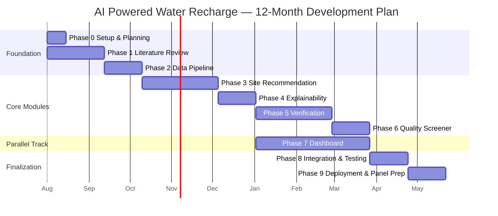

# Project Phases & Development Plan
## AI Powered Water Recharge

| | |
|---|---|
| **Document Version** | 1.0 |
| **Companion Documents** | AI_Powered_Water_Recharge_PRD.md, AI_Powered_Water_Recharge_Architecture.md, AI_Powered_Water_Recharge_Rules.md |
| **Total Duration** | 12 months |
| **Methodology** | Phase-gated development with parallel workstreams from Phase 5 onward |
| **Status** | Draft for Panel Review |

---

## 1. Planning Philosophy

This project follows a **phase-gated approach**: each phase has a defined entry point, a defined set of deliverables, and a defined exit criterion that must be met before the next phase formally begins. This is deliberate for a solo/small-team academic project — it prevents the common failure mode of a final-year project where every module is "80% done" at submission time but nothing is fully working end-to-end.

Two structural decisions shape this plan:

1. **Core MVP modules (Site Recommendation, Explainability, Verification, Dashboard) are built sequentially and are non-negotiable.** Stretch goals (Water Quality Screener, Abandoned Borewell Finder) are scheduled *after* the MVP is functionally complete, so a slipping stretch goal never threatens the core deliverable.
2. **Dashboard development starts early and runs in parallel** from Phase 5 onward, rather than being left until the very end — this avoids the classic last-month scramble to "wire everything into a UI."

---

## 2. Phase Summary Table

| Phase | Name | Duration | Months | Core Focus |
|---|---|---|---|---|
| 0 | Project Setup & Planning | 2 weeks | Month 1 (wks 1–2) | Repo, environments, documentation baseline |
| 1 | Literature Review & Requirements Finalization | 6 weeks | Month 1–2 | Research, PRD/Architecture sign-off |
| 2 | Data Pipeline & Infrastructure | 4 weeks | Month 2–3 | GEE, India-WRIS ingestion, database live |
| 3 | Module 1 — Site Recommendation Engine | 8 weeks | Month 3–5 | Core ML model trained and validated |
| 4 | Module 2 — Explainability Layer | 4 weeks | Month 5–6 | SHAP/LIME wired into Module 1 |
| 5 | Module 3 — Verification & Monitoring | 8 weeks | Month 6–8 | LSTM forecasting + deviation flagging |
| 6 | Module 4 — Water Quality Risk Screener | 4 weeks | Month 8–9 | Contamination risk scoring (stretch → core if on schedule) |
| 7 | Dashboard Development *(parallel, starts Month 7)* | 12 weeks | Month 7–10 | FastAPI + React + Leaflet integration |
| 8 | Integration, Testing & Hardening | 4 weeks | Month 10–11 | End-to-end system test, bug fixing |
| 9 | Deployment, Documentation & Panel Preparation | 4 weeks | Month 11–12 | Live deployment, final report, defense readiness |

---

## 3. Detailed Phase Breakdown

---

### Phase 0 — Project Setup & Planning
**Duration:** 2 weeks (Month 1, Weeks 1–2)
**Goal:** Establish the technical and documentation foundation before any feature work begins.

**Entry Criteria:** Project topic approved by guide/panel.

**Key Tasks:**
- Initialize Git repository with folder structure per Architecture doc Section 10
- Set up local development environment (Python venv, Node.js, Docker, PostgreSQL+PostGIS)
- Create Google Earth Engine account, request **Contributor Tier** upgrade immediately (per Rules doc Section 6.3)
- Create NASA Earthdata login, Copernicus Data Space account, register on India-WRIS/Bhuvan portals
- Set up `.env.example`, `.gitignore`, base `README.md`
- Finalize and circulate PRD, Architecture, and Rules documents to guide for sign-off

**Deliverables:**
- Working repository skeleton (empty modules, correct folder structure)
- All third-party accounts created and credentials tested with a "hello world" API call each
- PRD/Architecture/Rules documents approved

**Exit Criteria:** Can successfully authenticate and pull one sample layer from GEE, and one sample well reading from India-WRIS, end-to-end.

**Risks:** GEE Contributor Tier approval delay → *Mitigation:* apply immediately in Week 1; proceed with Community Tier in the meantime since 150 EECU-hours is sufficient for early small-scale testing.

---

### Phase 1 — Literature Review & Requirements Finalization
**Duration:** 6 weeks (Month 1–2)
**Goal:** Establish the academic foundation and lock the base paper and gap analysis.

**Entry Criteria:** Phase 0 complete.

**Key Tasks:**
- Complete the 15-paper literature survey across IEEE, Springer, and Google Scholar sources
- Finalize base paper selection (G-MCDA, Patidar et al. 2023) with documented justification
- Complete gap analysis mapping literature gaps to project objectives
- Write and finalize Literature Review chapter
- Confirm all data sources identified are genuinely free-tier accessible (cross-check per PRD Section 10)

**Deliverables:**
- Literature Review document (Chapter 2 equivalent)
- Finalized 5 Objectives with SOTA tech mapping
- Panel FAQ sheet (hardware/data-access justification)

**Exit Criteria:** Guide/panel has reviewed and accepted the literature review, base paper choice, and objectives without requesting a scope change.

**Risks:** Panel requests additional literature coverage → *Mitigation:* keep a running "candidate papers" backlog beyond the initial 15 so additions don't require a fresh research cycle.

---

### Phase 2 — Data Pipeline & Infrastructure
**Duration:** 4 weeks (Month 2–3)
**Goal:** Build the ingestion layer that feeds every downstream module.

**Entry Criteria:** Phase 0 infrastructure in place; Phase 1 data source list finalized.

**Key Tasks:**
- Implement `fetch_gee_layers.py` — Sentinel-1/2, Landsat, SRTM, MODIS pull for a single test district
- Implement `fetch_chirps.py` and `fetch_grace_fo.py`
- Implement `fetch_india_wris.py` with change-detection logic (per Rules doc Section 4)
- Design and migrate initial PostgreSQL+PostGIS schema (`sites`, `wells`, `well_readings`, `data_refresh_log`)
- Set up GitHub Actions scheduled workflow for daily India-WRIS refresh and weekly satellite refresh
- Cache first batch of processed satellite layers as GEE Assets

**Deliverables:**
- Working ingestion pipeline for one pilot district (recommend: Prayagraj or another district already covered in reviewed literature, for easy cross-validation)
- Populated database with real well-reading history for the pilot district
- Documented data source table (Architecture doc Section 10) confirmed against real usage

**Exit Criteria:** A scheduled job successfully runs unattended for 7 consecutive days, correctly logging success/failure to `data_refresh_log` each time.

**Risks:** India-WRIS portal structure makes scripted fetch difficult → *Mitigation:* fall back to India Data Portal CKAN API (Architecture doc Section 10) or scheduled semi-manual export as an acceptable interim solution, documented as a known limitation.

---

### Phase 3 — Module 1: Site Recommendation Engine
**Duration:** 8 weeks (Month 3–5)
**Goal:** Deliver a trained, validated site-suitability model for the pilot district, then generalize.

**Entry Criteria:** Phase 2 pipeline delivering clean feature data for the pilot district.

**Key Tasks (by sub-phase):**
- *Weeks 1–2:* Feature engineering — derive slope, drainage density, NDVI, soil classification from raw layers
- *Weeks 3–4:* Train baseline models (Logistic Regression, plain Random Forest) — record baseline metrics per Rules doc Section 5.3
- *Weeks 5–6:* Train and tune XGBoost as primary model; implement spatial (not random) train/test split
- *Week 7:* Validate against literature-reported accuracy ranges (AUC 0.82–0.98 per literature review); extend to a second, terrain-different district to test generalization
- *Week 8:* Freeze Module 1 v1.0 model artifact with full metadata (per Rules doc Section 5.6)

**Deliverables:**
- Trained XGBoost model achieving target AUC ≥ 0.85 (PRD Section 15)
- Baseline comparison report (Logistic Regression / RF vs. XGBoost)
- `/api/v1/sites/recommend` endpoint functional (without explainability yet — added in Phase 4)

**Exit Criteria:** Model produces sensible, spatially coherent suitability maps for two districts of different terrain type (e.g., one alluvial, one hard-rock), validated visually against known high/low groundwater zones.

**Risks:** Model accuracy low due to sparse ground-truth wells in pilot district → *Mitigation:* select pilot district specifically for well-data density during Phase 2 planning; document confidence levels for sparse-data regions rather than hiding the limitation.

---

### Phase 4 — Module 2: Explainability Layer
**Duration:** 4 weeks (Month 5–6)
**Goal:** Make every Module 1 prediction explainable by construction.

**Entry Criteria:** Module 1 v1.0 model frozen and available.

**Key Tasks:**
- Integrate SHAP TreeExplainer with the frozen XGBoost model
- Build the plain-language template engine converting top SHAP features into a sentence
- Add LIME as a secondary/comparison explainer for a sample of predictions (sanity-check SHAP output)
- Update `/api/v1/sites/{site_id}/explanation` endpoint
- User-test explanation phrasing with 2–3 non-technical reviewers (per PRD Risk table, Section 14) and refine wording

**Deliverables:**
- Every site recommendation returned by the API includes a non-empty explanation string (PRD Success Metric, Section 15)
- Short internal report comparing SHAP vs. LIME output consistency

**Exit Criteria:** 100% of Module 1 outputs in the test district include a valid, human-readable explanation with no template rendering errors.

**Risks:** Explanation phrasing too technical for target users → *Mitigation:* explicit user-testing step built into this phase, not deferred to the end.

---

### Phase 5 — Module 3: Verification & Monitoring
**Duration:** 8 weeks (Month 6–8)
**Goal:** Deliver the outcome-verification capability that differentiates this project from the base paper.

**Entry Criteria:** Phase 2 well-reading time-series data available and continuously refreshing.

**Key Tasks:**
- *Weeks 1–2:* Prepare time-series training data (windowing, normalization) from well-reading history
- *Weeks 3–5:* Train and tune Bi-LSTM forecasting model; benchmark against Facebook Prophet as a simpler baseline
- *Week 6:* Implement deviation-detection logic (predicted vs. actual, configurable threshold) and `verification_logs` write path
- *Week 7:* Backtest against historical data — simulate "what would this module have flagged 2 years ago" to validate logic against known outcomes
- *Week 8:* Wire verification re-check into the daily scheduled job (Architecture doc Section 7)

**Deliverables:**
- Trained Bi-LSTM forecasting model with documented RMSE/MAE (PRD Section 12)
- Working `/api/v1/structures/{structure_id}/verification` endpoint
- Backtest report demonstrating at least one correctly identified underperforming case in historical data (PRD Success Metric, Section 15)

**Exit Criteria:** Verification module runs automatically after each scheduled well-data refresh and correctly logs OK/Underperforming status without manual intervention.

**Risks:** No structures in the pilot district have clear "known underperforming" history to validate against → *Mitigation:* extend backtest search to any district in the India-WRIS dataset with clear multi-year decline trends, not restricted to the pilot district.

---

### Phase 6 — Module 4: Water Quality Risk Screener
**Duration:** 4 weeks (Month 8–9)
**Goal:** Add contamination-risk screening to complete the core+stretch module set.

**Entry Criteria:** Module 1 delivering candidate site coordinates reliably.

**Key Tasks:**
- Identify proxy data for pollution sources (land use layers for farmland/industrial zones; sewage infrastructure where available via open government data)
- Implement GIS buffer-distance feature computation
- Train RF/XGBoost risk classifier (Low/Medium/High)
- Integrate risk category into `sites` table and API response

**Deliverables:**
- Working risk classification attached to every Module 1 recommendation
- Documented data limitations (e.g., sewage-line data availability varies significantly by region — state clearly rather than overstating coverage)

**Exit Criteria:** Every site in the pilot district's recommendation output carries a risk category with no missing values.

**Risks:** High-quality pollution-source data unavailable for most of India → *Mitigation:* clearly scope this module's confidence to regions with available data, and document it as a known limitation rather than silently degrading accuracy.

*(Note: If Phase 3–5 run behind schedule, this phase is the first candidate to be descoped to "documented future work" per PRD Section 4.2 — it does not block core MVP delivery.)*

---

### Phase 7 — Dashboard Development *(Parallel Workstream)*
**Duration:** 12 weeks (Month 7–10, overlapping Phases 5–6)
**Goal:** Build the deployable web interface incrementally as backend modules become available, rather than as a final rushed integration.

**Entry Criteria:** Module 1 + Module 2 API endpoints functional (end of Phase 4).

**Key Tasks (incremental, module-by-module):**
- *Month 7:* FastAPI backend scaffolding, React app scaffolding, Leaflet map base layer rendering
- *Month 8:* Integrate Module 1+2 — map displays suitability scores and explanations per site
- *Month 9:* Integrate Module 3 — verification status displayed per structure, historical trend chart component
- *Month 10:* Integrate Module 4 (if on schedule) — risk category map styling; polish UI/UX, responsive layout, loading/error states (per Rules doc Section 7)

**Deliverables:**
- Functional web dashboard with region selection, map view, per-site detail panel
- Deployed staging environment (Render/Streamlit Community Cloud) updated continuously through this phase, not just at the end

**Exit Criteria:** A non-technical user (guide, classmate) can independently select a region, view recommendations with explanations, and check a structure's verification status without developer assistance.

**Risks:** Backend API changes breaking frontend integration mid-phase → *Mitigation:* API versioning under `/api/v1/` (Rules doc Section 7) and shared Pydantic schema definitions reduce this risk structurally.

---

### Phase 8 — Integration, Testing & Hardening
**Duration:** 4 weeks (Month 10–11)
**Goal:** Convert "modules that work individually" into "one system that works end-to-end reliably."

**Entry Criteria:** All in-scope modules (Phases 3–6) and dashboard (Phase 7) functionally complete.

**Key Tasks:**
- Full end-to-end test: new region → recommendation → explanation → risk screening → dashboard render
- Load-test the scheduled ingestion jobs across a full week without manual intervention
- Run the Definition of Done checklist (Rules doc Section 12) against every module
- Fix bugs surfaced during integration; no new features introduced in this phase
- Verify GEE quota consumption across a full realistic usage week stays within Contributor Tier budget (Rules doc Section 6.3)

**Deliverables:**
- Bug-fixed, stable system passing full end-to-end test on at least 2 districts
- Test report documenting what was tested and outcomes

**Exit Criteria:** Zero known critical bugs (system-breaking); all Definition of Done items checked for every module.

**Risks:** Integration reveals a deeper architectural issue late in the timeline → *Mitigation:* this is exactly why Phase 7 runs in parallel and incrementally rather than as a final push — most integration issues should surface and get fixed earlier, not accumulate here.

---

### Phase 9 — Deployment, Documentation & Panel Preparation
**Duration:** 4 weeks (Month 11–12)
**Goal:** Finalize the live deployment and prepare all submission materials.

**Entry Criteria:** Phase 8 exit criteria met.

**Key Tasks:**
- Finalize production deployment (Render/Streamlit Community Cloud), confirm live URL stability
- Finalize all documentation: PRD, Architecture, Rules, Phases (this doc), Literature Review, final project report
- Prepare panel presentation deck (objectives, architecture diagram, live demo, FAQ sheet)
- Conduct at least one full dry-run demo/defense with guide or peers
- Prepare "Future Scope" slide covering explicitly descoped items (Section 4.3 of PRD) so the panel sees them as deliberate scoping, not oversights

**Deliverables:**
- Live, publicly accessible deployed system
- Final project report incorporating all four core documents
- Presentation deck + rehearsed demo script
- Updated FAQ sheet (hardware/data-access/quota questions) ready for defense

**Exit Criteria:** System is demoable end-to-end live in front of a panel without developer intervention beyond navigation.

**Risks:** Free-tier hosting goes to sleep/cold-starts during a live demo → *Mitigation:* "warm up" the deployed instance 10–15 minutes before the actual panel session; have a recorded screen-capture backup demo video as a fallback.

---

## 4. Phase Dependency Overview

---

## 5. Milestone Review Checkpoints

| Checkpoint | End of Phase | Panel/Guide Review Focus |
|---|---|---|
| Milestone 1 | Phase 1 | Literature review depth, base paper justification, objective clarity |
| Milestone 2 | Phase 2 | Data pipeline reliability, free-tier feasibility proof |
| Milestone 3 | Phase 4 | Core AI capability demonstrated (recommendation + explainability) |
| Milestone 4 | Phase 6 | Full module set complete, verification module differentiator demonstrated |
| Milestone 5 | Phase 8 | End-to-end system stability |
| Final Review | Phase 9 | Live demo, full documentation set, defense readiness |

---

## 6. Contingency Buffer

No phase in this plan has zero slack, but if delays accumulate, the priority order for descoping (from PRD Section 4) is:

1. First to cut/reduce: Phase 6 (Water Quality Screener) — move to documented future scope
2. Second to cut/reduce: Phase 7's final polish items (advanced UI styling, non-essential chart types) — keep the dashboard functional, not necessarily beautiful
3. Never cut: Phases 3, 4, 5 (Site Recommendation, Explainability, Verification) — these three modules are the project's core intellectual contribution and must be delivered in full

---

*End of Document*
