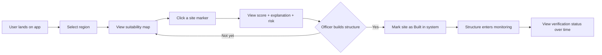
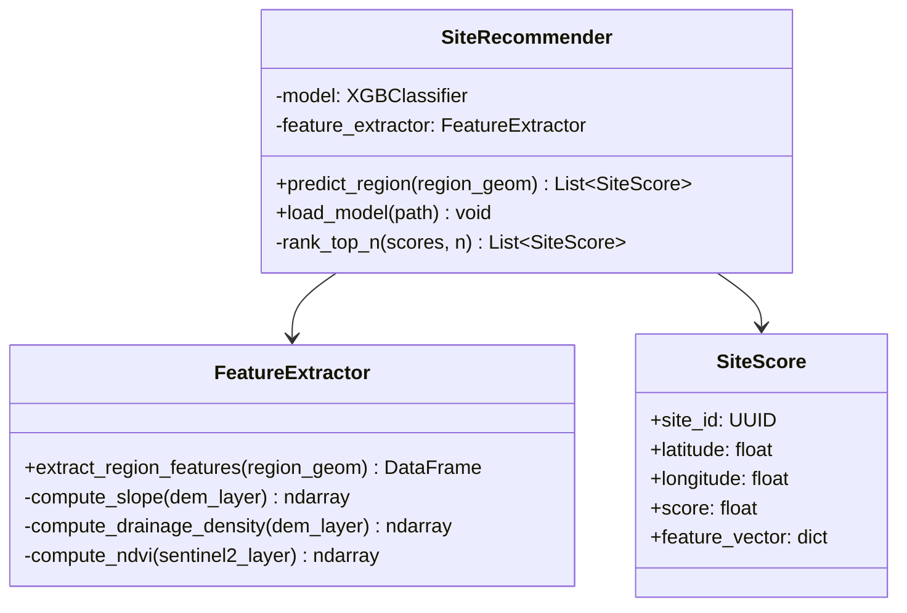
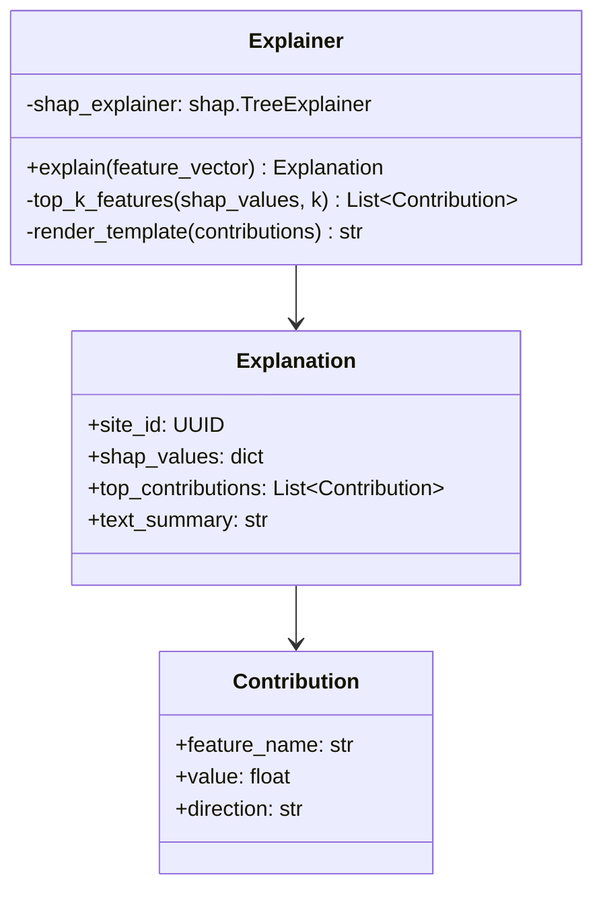
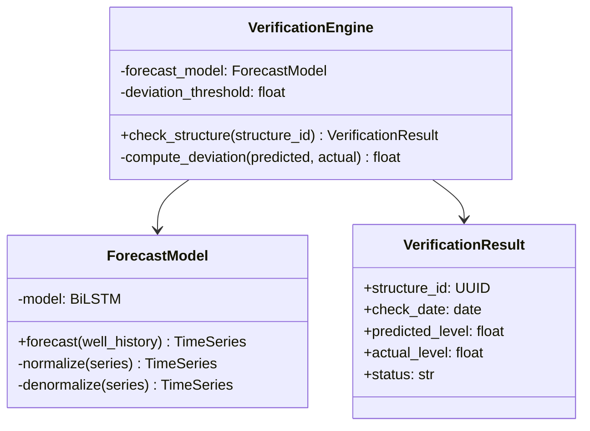
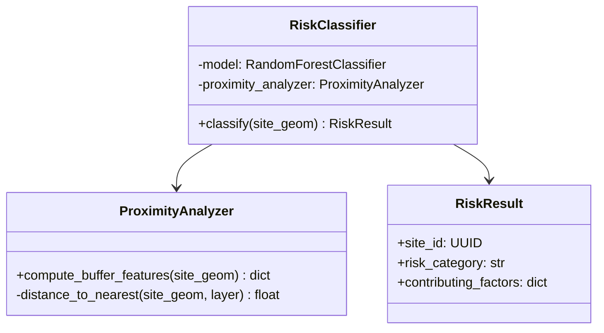

# System Design Document
## AI Powered Water Recharge

| | |
|---|---|
| **Document Version** | 1.0 |
| **Companion Documents** | PRD.md (what to build), Architecture.md (high-level system design), Rules.md (how to build), Phases.md (when to build) |
| **This Document Covers** | Low-level design: UI/UX design, module-level class/function design, algorithm design, detailed data model, design patterns, design decisions |
| **Status** | Draft for Panel Review |

---

## 1. Relationship to the Architecture Document

The Architecture document answers **"what are the components and how do they connect?"** (high-level design). This document answers **"exactly how is each component built internally?"** (low-level design) — down to class structures, function signatures, algorithms, UI layouts, and field-level data specifications. A developer (or an AI coding assistant) should be able to start writing code directly from this document without needing to make additional design decisions.

---

## 2. UI/UX Design

### 2.1 Design Principles
1. **Map-first, not form-first** — the primary interaction surface is the map; controls and data are layered around it, not the other way around.
2. **Explain everything visible** — no score, color, or icon appears without a way to click/tap through to a plain-language explanation.
3. **Officer-usable, not developer-usable** — every screen must be navigable by someone with no GIS or ML background.
4. **Graceful degradation** — if a backend call fails (e.g., GEE quota throttling), the UI shows a clear, non-technical message, never a blank screen or raw error.

### 2.2 Color & Visual Language

| Element | Meaning | Color |
|---|---|---|
| High suitability site | Strong recommendation | Green (`#2E7D32`) |
| Medium suitability site | Moderate recommendation | Amber (`#F9A825`) |
| Low suitability site | Weak recommendation | Grey (`#9E9E9E`) |
| High contamination risk | Warning overlay | Red (`#C62828`) |
| Verified structure — OK | Positive monitoring status | Blue (`#1565C0`) |
| Verified structure — Underperforming | Needs attention | Orange (`#EF6C00`) |
| Base map / neutral UI | Background/chrome | Navy (`#1F3864`) + white |

### 2.3 Page/Screen Inventory

| Screen | Purpose | Primary Components |
|---|---|---|
| **Landing / Region Selector** | Entry point — choose state/district or draw custom polygon | Region dropdown, map preview, "Analyze Region" button |
| **Map Dashboard** (primary screen) | Core interaction surface | Leaflet map, suitability layer toggle, risk layer toggle, structure markers, sidebar list |
| **Site Detail Panel** | Deep-dive into one recommended site | Score, SHAP explanation text, risk category, "Mark as Built" action |
| **Structure Verification View** | Monitoring history for a built structure | Predicted vs. actual trend chart, status badge, historical log table |
| **Data Freshness Panel** | Transparency on data currency | Last-refreshed timestamp per data source, pulled from `data_refresh_log` |

### 2.4 Wireframe — Map Dashboard (Primary Screen)

```
┌─────────────────────────────────────────────────────────────────┐
│  AI POWERED WATER RECHARGE         [Region: Prayagraj ▾]  [ℹ]     │
├───────────────┬─────────────────────────────────────────────────┤
│  Layers        │                                                 │
│  [x] Suitability│                                                │
│  [x] Risk       │                                                │
│  [ ] Structures │              < LEAFLET MAP VIEW >              │
│                 │         (color-coded suitability grid,         │
│  Site List      │          site markers, structure pins)         │
│  ┌───────────┐ │                                                 │
│  │ Site #142  │ │                                                 │
│  │ Score: 0.91│ │                                                 │
│  │ Risk: Low  │ │                                                 │
│  └───────────┘ │                                                 │
│  ┌───────────┐ │                                                 │
│  │ Site #087  │ │                                                 │
│  │ Score: 0.84│ │                                                 │
│  │ Risk: Med  │ │                                                 │
│  └───────────┘ │                                                 │
├───────────────┴─────────────────────────────────────────────────┤
│  Data last refreshed: Satellite — 3 days ago | Wells — Today      │
└─────────────────────────────────────────────────────────────────┘
```

### 2.5 Wireframe — Site Detail Panel

```
┌───────────────────────────────────────────┐
│  Site #142                          [✕]    │
├───────────────────────────────────────────┤
│  Suitability Score:  0.91 / 1.00  ▓▓▓▓▓▓▓░ │
│  Contamination Risk: Low                    │
│                                             │
│  Why this site was recommended:            │
│  "High suitability due to steep slope,     │
│   absorbent soil, and strong nearby         │
│   rainfall. Minor negative contribution     │
│   from distance to nearest river."          │
│                                             │
│  Top Contributing Factors (SHAP):          │
│   Slope            ██████████ +0.34         │
│   Soil Type         ████████  +0.28          │
│   Rainfall           ██████   +0.19           │
│   River Distance      ██     -0.06             │
│                                             │
│  [ Mark as Built ]   [ View on Full Map ]  │
└───────────────────────────────────────────┘
```

### 2.6 User Flow — Primary Path (Recommend → Verify)



---

## 3. Module-Level Design

### 3.1 Module 1 — Site Recommendation Engine



**Key function signature:**
```python
def predict_region(
    self,
    region_geom: shapely.Polygon,
    grid_resolution_m: int = 250,
    top_n: int = 50,
) -> list[SiteScore]:
    """
    Score every grid cell in the given region and return the top_n
    highest-suitability sites.

    Args:
        region_geom: Region boundary as a Shapely polygon.
        grid_resolution_m: Grid cell size in meters (default 250m,
            balances compute cost against spatial precision).
        top_n: Number of top-ranked sites to return.

    Returns:
        List of SiteScore objects, sorted descending by score.
    """
```

**Algorithm — Site Scoring Pipeline:**
1. Tessellate `region_geom` into a grid of `grid_resolution_m` cells.
2. For each cell, pull cached feature layers (slope, soil, LULC, rainfall, drainage, geology) from PostGIS/GEE Assets.
3. Assemble a feature vector per cell in the exact column order the model was trained on (enforced via a stored feature-order manifest to prevent silent misalignment).
4. Run `model.predict_proba()` to get suitability score `[0, 1]`.
5. Sort descending, return `top_n`.

---

### 3.2 Module 2 — Explainability Layer



**Key function signature:**
```python
def explain(self, site_id: UUID, feature_vector: dict) -> Explanation:
    """
    Generate a SHAP-based explanation for a single site's prediction.

    Args:
        site_id: Identifier of the site being explained.
        feature_vector: The exact feature vector used for prediction.

    Returns:
        Explanation object containing raw SHAP values, the top 3
        contributing factors, and a human-readable summary sentence.
    """
```

**Sentence template design (rule-based, deterministic — not an LLM call, to keep this module free, fast, and fully explainable itself):**
```
"{High/Moderate/Low} suitability due to {factor_1} and {factor_2}."
  + optional: " Minor negative contribution from {factor_3}."
```
Factor names are mapped from internal feature keys (`slope_deg`, `soil_clay_pct`) to human phrases (`"steep slope"`, `"absorbent soil"`) via a static lookup dictionary — this mapping is a reviewable, editable config file, not hardcoded inline, so wording can be refined during Phase 4 user-testing without touching model code.

---

### 3.3 Module 3 — Verification & Monitoring



**Key function signature:**
```python
def check_structure(self, structure_id: UUID) -> VerificationResult:
    """
    Compare forecasted vs. actual groundwater trend for the wells
    nearest a given structure, and flag deviation if it exceeds
    the configured threshold.

    Args:
        structure_id: Identifier of the built structure to check.

    Returns:
        VerificationResult with status 'OK' or 'Underperforming'.

    Raises:
        InsufficientDataError: if fewer than the minimum required
            historical readings exist for a reliable forecast.
    """
```

**Algorithm — Deviation Detection:**
1. Retrieve the nearest N wells (default N=3) to the structure's coordinates within a configurable radius.
2. Retrieve each well's historical reading series; forecast the next expected value(s) using the trained Bi-LSTM.
3. Compare the latest actual reading against the forecast: `deviation = (predicted - actual) / predicted`.
4. If `deviation > threshold` (default 15%, configurable) for the majority of nearby wells, flag `Underperforming`; otherwise `OK`.
5. Persist result to `verification_logs`.

**Design decision:** deviation is computed as a *relative*, not absolute, percentage — this avoids the model being either overly sensitive in low-water regions or under-sensitive in high-water regions, since absolute meter-level thresholds behave very differently across India's varied hydrogeology.

---

### 3.4 Module 4 — Water Quality Risk Screener



**Algorithm — Risk Feature Computation:**
1. Compute Euclidean/geodesic distance from the candidate site to the nearest: farmland boundary, industrial zone polygon, known sewage/drainage line.
2. Normalize distances into `[0, 1]` proximity-risk scores (closer = higher risk).
3. Feed into `RandomForestClassifier.predict()` → discrete category (`Low` / `Medium` / `High`).

---

## 4. Detailed Data Model (Field-Level)

### 4.1 `sites`
| Field | Type | Constraints | Notes |
|---|---|---|---|
| `site_id` | UUID | PK, default `gen_random_uuid()` | |
| `latitude` | FLOAT | NOT NULL, range [-90, 90] | |
| `longitude` | FLOAT | NOT NULL, range [-180, 180] | |
| `region` | VARCHAR(100) | NOT NULL, indexed | e.g., `"Prayagraj"` |
| `suitability_score` | FLOAT | NOT NULL, range [0, 1] | |
| `risk_category` | VARCHAR(10) | ENUM('Low','Medium','High'), nullable | Null until Module 4 runs |
| `model_version` | VARCHAR(30) | NOT NULL | Traceability to trained model artifact |
| `created_at` | TIMESTAMP | NOT NULL, default now() | |

### 4.2 `well_readings`
| Field | Type | Constraints | Notes |
|---|---|---|---|
| `reading_id` | UUID | PK | |
| `well_id` | UUID | FK → `wells.well_id`, indexed | |
| `reading_date` | DATE | NOT NULL | |
| `water_level` | FLOAT | NOT NULL | Meters below ground level |
| `source_updated_at` | TIMESTAMP | NOT NULL | Used for change-detection during ingestion |
| UNIQUE constraint | `(well_id, reading_date)` | | Prevents duplicate ingestion |

### 4.3 `verification_logs`
| Field | Type | Constraints | Notes |
|---|---|---|---|
| `log_id` | UUID | PK | |
| `structure_id` | UUID | FK → `structures.structure_id`, indexed | |
| `check_date` | DATE | NOT NULL | |
| `predicted_level` | FLOAT | NOT NULL | |
| `actual_level` | FLOAT | NOT NULL | |
| `deviation_pct` | FLOAT | NOT NULL | Computed field, stored for fast querying/charting |
| `status` | VARCHAR(20) | ENUM('OK','Underperforming') | |

*(Remaining tables — `site_features`, `explanations`, `structures`, `wells`, `data_refresh_log` — follow the same field-level detail pattern; full DDL lives in `backend/app/db/migrations/`.)*

---

## 5. Design Patterns Used

| Pattern | Where Used | Why |
|---|---|---|
| **Repository Pattern** | Database access layer (`app/db/repositories/`) | Isolates SQLAlchemy query logic from business logic in the ML/API layers, making it easy to test modules with mocked data |
| **Strategy Pattern** | Model loading (`SiteRecommender.load_model()`) | Allows swapping XGBoost for an alternative model (e.g., LightGBM) without changing calling code |
| **Factory Pattern** | Explanation template rendering | Different explanation phrasing strategies (short vs. detailed) can be produced from one factory without duplicating logic |
| **Chain of Responsibility (implicit)** | Module 1 → Module 2 → Module 4 pipeline | Each module enriches the site record and passes it forward; any module can be skipped/disabled without breaking the others |
| **Adapter Pattern** | Data ingestion scripts (`fetch_*.py`) | Each external source (GEE, CHIRPS, India-WRIS) has a different raw format; each adapter normalizes it to a common internal schema before storage |

---

## 6. Error Handling Design

| Scenario | Design Response |
|---|---|
| GEE quota exhausted mid-request | Catch `ee.EEException`, fall back to last cached GEE Asset, log a `data_refresh_log` warning entry, continue serving stale-but-labeled data |
| India-WRIS fetch script fails (site down/layout change) | Retry with exponential backoff (3 attempts), then log failure and alert via GitHub Actions job failure notification — does not crash the scheduler for other jobs |
| Insufficient well data near a structure for verification | Raise `InsufficientDataError`, API returns a clear "Not enough monitoring data yet" message rather than a wrong forecast |
| Frontend API call fails | Display a non-blocking toast/banner: "Data temporarily unavailable, showing last known results" — never a blank screen |
| Invalid region polygon submitted | Pydantic validation rejects at the API boundary with HTTP 422 and a specific field-level error message |

---

## 7. Frontend State Management Design

- **Global state:** selected region, active map layers (toggle states), currently selected site/structure — managed via React Context (lightweight, sufficient for this app's scope; Redux is unnecessary complexity for a project this size).
- **Server state:** API responses (site lists, explanations, verification logs) — managed via a simple fetch-and-cache hook pattern (`useApiData`), with manual refresh rather than complex real-time sync, consistent with the project's scheduled-refresh philosophy (Rules doc Section 1).
- **Local component state:** UI-only concerns (panel open/closed, hover states) — standard `useState`, not lifted to global state.

---

## 8. Key Design Decisions & Trade-offs

| Decision | Alternative Considered | Why This Choice |
|---|---|---|
| Grid-based site scoring (Module 1) rather than point-based only | Score only pre-defined candidate points | Grid scoring produces a full suitability *surface*, matching how G-MCDA (base paper) presents results, and gives officers spatial context, not just a list |
| Rule-based explanation templates rather than an LLM-generated explanation | Use a small LLM to phrase explanations | Keeps Module 2 fully deterministic, free (no API cost), fast, and — critically — itself explainable/debuggable, avoiding a second black box on top of the first |
| Relative (%) deviation threshold in Module 3 | Absolute meter-based threshold | Generalizes across India's highly variable regional groundwater baselines (per Architecture doc's regional-diversity gap) |
| React Context over Redux | Redux/Zustand | Project scope doesn't justify the added complexity/learning overhead within a 1-year solo/small-team timeline |
| Scheduled batch verification over real-time triggers | Event-driven real-time verification | Matches the physically slow-changing nature of groundwater data; avoids unnecessary infrastructure complexity (Rules doc Section 1, Principle 5) |

---

*End of Document*
