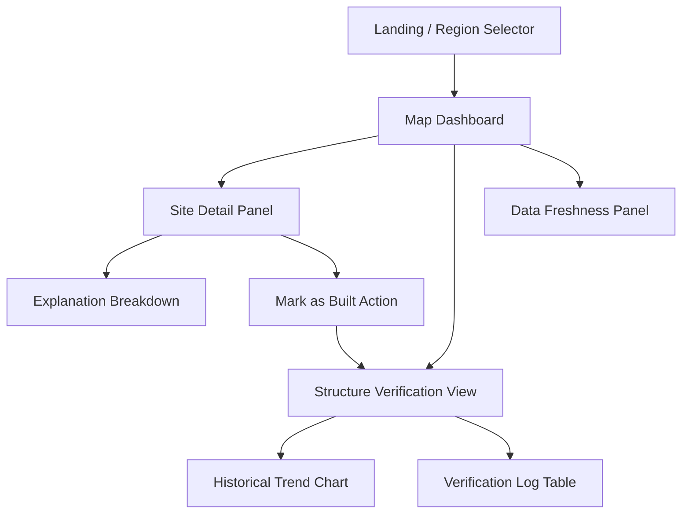
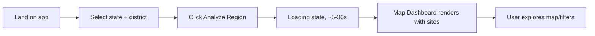
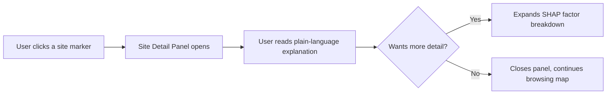
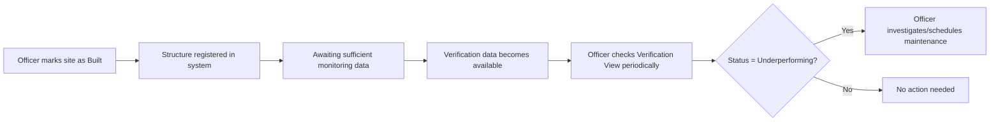

# UI/UX Design Specification
## AI Powered Water Recharge

| | |
|---|---|
| **Document Version** | 1.0 |
| **Companion Documents** | PRD.md, Architecture.md, Design.md, Rules.md, Phases.md |
| **Scope** | Complete interface design: personas, information architecture, screen specs, component library, interaction patterns, responsive & accessibility rules |
| **Primary Frontend Stack** | React.js + Leaflet.js (per Architecture.md Section 9) |
| **Status** | Draft for Panel Review |

---

## 1. Design Philosophy & Goals

This interface is built for **field-adjacent government officers, not data scientists**. Every design decision is filtered through one question: *"Would a district groundwater officer with no GIS or ML background understand this in under 10 seconds?"*

**Five governing principles:**
1. **Map-first, not form-first** — the map is the product; menus and panels are supporting scaffolding around it.
2. **Explain everything visible** — no score, color, or badge appears without a one-tap path to a plain-language reason.
3. **Progressive disclosure** — the default view is simple (a color on a map); complexity (SHAP charts, historical logs) is available on demand, never forced on the user upfront.
4. **Never a blank/broken state** — every possible failure (no data, loading, API error) has a designed, human-readable state — never a raw error or empty white screen.
5. **Consistent visual language for trust and risk** — the same colors mean the same thing everywhere in the app, so a user builds pattern recognition over repeated use.

---

## 2. User Personas

| Persona | Description | Primary Goal | Technical Comfort |
|---|---|---|---|
| **District Groundwater Officer** (primary) | Government official responsible for approving new recharge structure locations | Quickly identify and justify the best sites in their district | Low-to-medium; comfortable with basic web apps, not GIS software |
| **Panchayat-Level Official** (secondary) | Local-level administrator overseeing village-scale water infrastructure | Check status of structures in their village, understand simple recommendations | Low; may primarily use a mobile browser |
| **Project Evaluator / Panel Member** (tertiary) | Academic evaluator reviewing the system | Understand system capability quickly during a live demo | High (technical), but time-constrained during a demo |

---

## 3. Information Architecture



**Navigation rule:** the app never exceeds 2 levels of depth from the Map Dashboard — every detail view is a panel/overlay on top of the map, not a separate page requiring a full navigation trip back.

---

## 4. Design Tokens

### 4.1 Color System

| Token | Hex | Usage |
|---|---|---|
| `color-primary` | `#1F3864` (Navy) | Header, primary buttons, active nav states |
| `color-primary-light` | `#2E5395` | Secondary buttons, hover states |
| `color-success` | `#2E7D32` | High suitability, "OK" verification status |
| `color-warning` | `#F9A825` | Medium suitability, Medium risk |
| `color-danger` | `#C62828` | High contamination risk |
| `color-info` | `#1565C0` | Neutral informational badges |
| `color-alert` | `#EF6C00` | Underperforming structure status |
| `color-neutral-bg` | `#F5F7FA` | Page background |
| `color-neutral-border` | `#D7DEE8` | Card borders, dividers |
| `color-text-primary` | `#1A1A1A` | Body text |
| `color-text-secondary` | `#595959` | Captions, metadata |

**Rule:** color is never the *only* signal — every colored badge also carries a text label (e.g., "High" not just red), for accessibility and because officers may reasonably view this on a low-quality screen in the field.

### 4.2 Typography

| Token | Font | Size | Weight | Usage |
|---|---|---|---|---|
| `text-h1` | Inter / system-ui | 24px | 700 | Page/app title |
| `text-h2` | Inter / system-ui | 18px | 600 | Panel section headers |
| `text-body` | Inter / system-ui | 14px | 400 | Standard body text |
| `text-caption` | Inter / system-ui | 12px | 400 | Metadata, timestamps |
| `text-badge` | Inter / system-ui | 11px | 600 | Status badges (uppercase) |

### 4.3 Spacing Scale
`4px, 8px, 12px, 16px, 24px, 32px, 48px` — all padding/margin values are drawn from this scale; no arbitrary pixel values in component styling (enforced via Tailwind spacing config or a shared CSS variables file).

### 4.4 Elevation / Shadow
| Token | Usage |
|---|---|
| `shadow-card` | `0 1px 3px rgba(0,0,0,0.12)` — site list cards, panels |
| `shadow-modal` | `0 4px 16px rgba(0,0,0,0.20)` — detail panel overlay |

---

## 5. Screen-by-Screen Specification

### 5.1 Screen: Landing / Region Selector

**Purpose:** First screen a user sees; sets the analysis scope for the session.

```
┌─────────────────────────────────────────────────────────┐
│                                                           │
│              AI POWERED WATER RECHARGE                    │
│      Smart site selection & verification for groundwater  │
│                    recharge structures                     │
│                                                           │
│   Select a region to begin:                               │
│   ┌─────────────────────────────┐                        │
│   │ State: [ Uttar Pradesh  ▾ ]  │                        │
│   │ District: [ Prayagraj  ▾ ]   │                        │
│   └─────────────────────────────┘                        │
│                                                           │
│           [   Analyze Region  →   ]                       │
│                                                           │
│   or draw a custom area on the map: [ Draw Custom Area ]  │
│                                                           │
└─────────────────────────────────────────────────────────┘
```

**Components:** State dropdown, District dropdown (dependent on state selection), primary CTA button, secondary text-link action for custom polygon drawing.

**States:**
- *Default:* dropdowns empty, CTA disabled until both selected
- *Loading (after CTA click):* CTA becomes a spinner + "Preparing your region's data…" — see Section 8.1
- *Error:* if the selected region has no cached data and live GEE processing fails, show inline message: "We couldn't load data for this region right now. Try a smaller area or check back shortly."

---

### 5.2 Screen: Map Dashboard (Primary Screen)

**Purpose:** Core working screen — view, filter, and interact with recommendations across the selected region.

```
┌───────────────────────────────────────────────────────────────────┐
│ ☰  AI POWERED WATER RECHARGE      Region: Prayagraj ▾      [ℹ] [⟳]  │
├───────────────┬───────────────────────────────────────────────────┤
│ LAYERS         │                                                   │
│ [x] Suitability│                                                   │
│ [x] Risk       │                                                   │
│ [ ] Structures │                                                   │
│                │                                                   │
│ FILTER         │              < LEAFLET MAP >                     │
│ Min score: 0.7 │     (choropleth suitability + site markers +      │
│ [───●────]     │      structure pins, color-coded per Section 4.1) │
│                │                                                   │
│ SITE LIST (12) │                                                   │
│ ┌─────────────┐│                                                   │
│ │ #142  0.91  ││                                                   │
│ │ Risk: Low   ││                                                   │
│ └─────────────┘│                                                   │
│ ┌─────────────┐│                                                   │
│ │ #087  0.84  ││                                                   │
│ │ Risk: Medium││                                                   │
│ └─────────────┘│                                                   │
│      ⋮         │                                                   │
├───────────────┴───────────────────────────────────────────────────┤
│ Data refreshed: Satellite — 3 days ago  |  Wells — Today   [Details]│
└───────────────────────────────────────────────────────────────────┘
```

**Components:**
- **Top bar:** app title, region switcher, info icon (opens FAQ/help), manual refresh icon
- **Left sidebar (collapsible on mobile — see Section 7):** layer toggles, score filter slider, scrollable site list (cards synced with map — clicking a card pans/zooms the map and opens the pin's popup)
- **Map canvas:** Leaflet map with a choropleth suitability layer, discrete site markers, optional structure pins, standard zoom/pan controls
- **Bottom status bar:** data freshness summary, links to the Data Freshness Panel (Section 5.5)

**Interaction rules:**
- Clicking a map marker OR a sidebar card opens the **Site Detail Panel** as a right-side slide-in overlay (not a new page) — map stays visible and interactive underneath.
- Layer toggles and the score filter apply instantly (client-side filtering on already-fetched data) — no reload/spinner for filtering, only for a full region change.

---

### 5.3 Screen: Site Detail Panel

**Purpose:** Deep-dive on one specific candidate site, including the explanation.

```
┌─────────────────────────────────────┐
│  Site #142                     [✕]   │
├─────────────────────────────────────┤
│  Suitability Score                    │
│  0.91 / 1.00   ▓▓▓▓▓▓▓▓▓░            │
│                                       │
│  Contamination Risk:  ● Low          │
│                                       │
│  ── Why this site? ──────────────    │
│  "High suitability due to steep       │
│   slope, absorbent soil, and strong   │
│   nearby rainfall. Minor negative     │
│   contribution from distance to       │
│   nearest river."                     │
│                                       │
│  [ Show detailed factor breakdown ▾ ] │
│  ┌─────────────────────────────────┐│
│  │ Slope           ██████████ +0.34 ││
│  │ Soil Type        ████████ +0.28  ││
│  │ Rainfall          ██████  +0.19  ││
│  │ River Distance      ██   -0.06  ││
│  └─────────────────────────────────┘│
│                                       │
│  [    Mark as Built    ]             │
│  [    View on Full Map    ]          │
└─────────────────────────────────────┘
```

**Progressive disclosure rule:** the plain-language sentence is always visible by default; the SHAP bar-chart breakdown is collapsed behind a "Show detailed factor breakdown" toggle — this directly implements Design Principle 3 (Section 1).

**"Mark as Built" flow:** clicking this opens a small confirmation form (build date picker, structure type dropdown) before creating a `structures` record and transitioning the site into the Verification workflow (Section 5.4).

---

### 5.4 Screen: Structure Verification View

**Purpose:** Show whether a built structure is actually working, over time.

```
┌───────────────────────────────────────────────┐
│  Structure #142-A          Status: ● OK  [✕]    │
├───────────────────────────────────────────────┤
│  Built: 12 Mar 2027   Type: Check Dam           │
│                                                 │
│  Predicted vs. Actual Water Level                │
│  ┌─────────────────────────────────────────┐  │
│  │        ╭─╮                                │  │
│  │      ╭─╯ ╰╮      ← predicted (dashed)      │  │
│  │  ╭──╯     ╰──╮   ← actual (solid)          │  │
│  │ ╱                                          │  │
│  └─────────────────────────────────────────┘  │
│   Jan   Mar   May   Jul   Sep   Nov            │
│                                                 │
│  Verification History                            │
│  ┌───────────┬───────────┬───────────┬───────┐│
│  │ Date       │ Predicted │ Actual    │ Status││
│  ├───────────┼───────────┼───────────┼───────┤│
│  │ 2027-11-01 │ 4.2m      │ 4.0m      │ OK    ││
│  │ 2027-10-01 │ 4.5m      │ 4.6m      │ OK    ││
│  └───────────┴───────────┴───────────┴───────┘│
└───────────────────────────────────────────────┘
```

**Status badge design:** the badge in the header is the single most important element on this screen — it must be legible at a glance (colored dot + text label, per Section 4.1's "never color alone" rule).

**Empty state (structure too new for verification data):** "This structure was built recently — verification data will appear once enough monitoring history is available (usually within 1–2 months)." No chart is shown; a simple icon + message replaces it.

---

### 5.5 Screen/Component: Data Freshness Panel

**Purpose:** Build user trust by being transparent about exactly how current the underlying data is — directly supports the panel-facing "is this real-time?" conversation.

```
┌─────────────────────────────────────┐
│  Data Freshness                [✕]   │
├─────────────────────────────────────┤
│  Satellite imagery     3 days ago    │
│  Rainfall data          7 days ago    │
│  Groundwater wells       Today        │
│  Groundwater storage    This month     │
│                                       │
│  ℹ Groundwater changes gradually —     │
│    daily updates are more than         │
│    sufficient for accurate monitoring. │
└─────────────────────────────────────┘
```

This panel exists specifically so the interface itself pre-answers the "is this real-time?" question your panel raised earlier — the honesty about refresh cadence is a *feature*, not something to hide.

---

## 6. Component Library

| Component | Variants | Notes |
|---|---|---|
| `Button` | Primary, Secondary, Text-link | Primary = navy fill; Secondary = navy outline; disabled state at 40% opacity |
| `Badge` | Score (color+number), Risk (color+label), Status (dot+label) | Always icon/color + text, never color alone (Section 4.1) |
| `Card` | Site list card, Structure list card | `shadow-card`, 8px border-radius, hover state raises to `shadow-modal` |
| `Slider` | Score filter | Shows live numeric value while dragging |
| `Dropdown` | Region selector, layer toggle group | Native `<select>` on mobile for accessibility; custom styled on desktop |
| `Panel/Drawer` | Site Detail, Structure Verification, Data Freshness | Slides in from the right (desktop) or bottom (mobile), dismissible via `✕` or tap-outside |
| `Toast/Banner` | Error, Warning, Info | Non-blocking, auto-dismiss after 6s for Info, persistent until dismissed for Error |
| `Chart` | Predicted vs. Actual line chart, SHAP bar chart | Built with a lightweight charting lib (e.g., Recharts); always paired with a text alternative for the same data (accessibility) |

---

## 7. Responsive Design Rules

| Breakpoint | Layout Behavior |
|---|---|
| Desktop (≥1024px) | Full sidebar + map side-by-side; detail panels slide in from the right at fixed width (~380px) |
| Tablet (768–1023px) | Sidebar collapses to an icon-triggered overlay; map takes full width by default |
| Mobile (<768px) | Map is the default full-screen view; site list becomes a bottom sheet (swipe-up); detail panels become full-screen takeovers, not side panels, since panchayat-level users are the most likely to be on mobile browsers (Persona 2, Section 2) |

**Touch target rule:** all interactive elements maintain a minimum 44x44px touch target on mobile, regardless of visual size, per standard mobile accessibility guidance.

---

## 8. Interaction & Feedback States

### 8.1 Loading States
- **Region-level load (first analysis):** full-panel skeleton loader with message "Preparing your region's data…" — expected duration communicated if >5 seconds typically ("This can take up to 30 seconds for larger regions").
- **Panel-level load (opening a site detail):** localized spinner inside the panel only; map and rest of UI remain interactive.
- **Never** a full-page blocking spinner for anything except the very first region load.

### 8.2 Error States
| Scenario | UI Response |
|---|---|
| Backend API unreachable | Persistent top banner: "Data temporarily unavailable — showing last known results." (per Design.md Section 6 error handling design) |
| No sites meet current filter | Empty-state illustration + text: "No sites match your current filter. Try lowering the minimum score." |
| GEE quota throttling in effect | Non-alarming info banner: "Analysis is running a bit slower than usual today." — never expose internal quota/technical detail to this user persona |
| Invalid/unsupported region drawn | Inline validation message under the draw tool: "Please select an area within India to continue." |

### 8.3 Empty States
Every list/chart component has a defined empty state with an icon + one-sentence explanation + (where applicable) a suggested next action — never a literally blank space, which reads as broken rather than empty.

### 8.4 Micro-interactions
- Site markers on the map scale up slightly (110%) on hover (desktop) to signal interactivity.
- Score bars (Section 5.3) animate a fill-in on panel open (200ms ease-out) — small, purposeful motion only, not decorative.
- Status badges use a subtle pulse animation only for "Underperforming" status, to draw appropriate attention without being alarming.

---

## 9. Accessibility Requirements

- All color-coded meaning is paired with text/icon (Section 4.1) — supports color-blind users.
- Minimum contrast ratio of 4.5:1 for all body text against its background (WCAG AA).
- All interactive elements reachable and operable via keyboard (tab order follows visual layout: top bar → sidebar → map → panel).
- Map markers and choropleth regions include `aria-label` equivalents summarizing the same data available visually, so the core recommendation data is not map-only/visual-only.
- Charts (Section 6) always paired with an underlying data table view toggle, for both accessibility and for users who prefer precise numbers over visual trend-reading.

---

## 10. Key User Flows

### 10.1 Flow: First-Time Region Analysis


### 10.2 Flow: Investigating a Recommendation


### 10.3 Flow: Post-Construction Monitoring


---

## 11. Usability Heuristics Checklist (Nielsen-Based, Applied)

| Heuristic | How This Design Satisfies It |
|---|---|
| Visibility of system status | Data Freshness Panel, loading states, status badges |
| Match between system and real world | Plain-language explanations instead of raw SHAP values by default |
| User control and freedom | Every panel dismissible; filters instantly reversible |
| Consistency and standards | Single color/token system applied everywhere (Section 4) |
| Error prevention | Dropdown-constrained region selection prevents invalid input at the source |
| Recognition rather than recall | Site list + map stay synchronized; user never needs to remember an ID |
| Flexibility and efficiency of use | Score filter and layer toggles allow power users to narrow results quickly, while defaults work fine for first-time users |
| Aesthetic and minimalist design | Progressive disclosure keeps default views simple (Section 5.3) |
| Help users recognize/diagnose/recover from errors | Section 8.2 error states are specific and actionable, not generic |
| Help and documentation | Info icon in top bar links to a short in-app FAQ (reuses Panel FAQ Sheet content) |

---

*End of Document*
